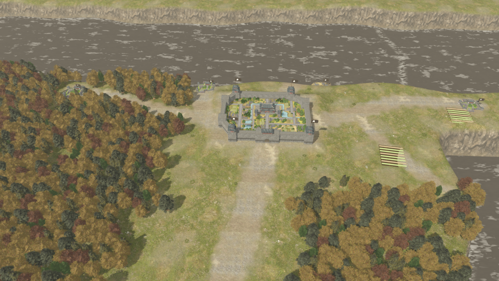
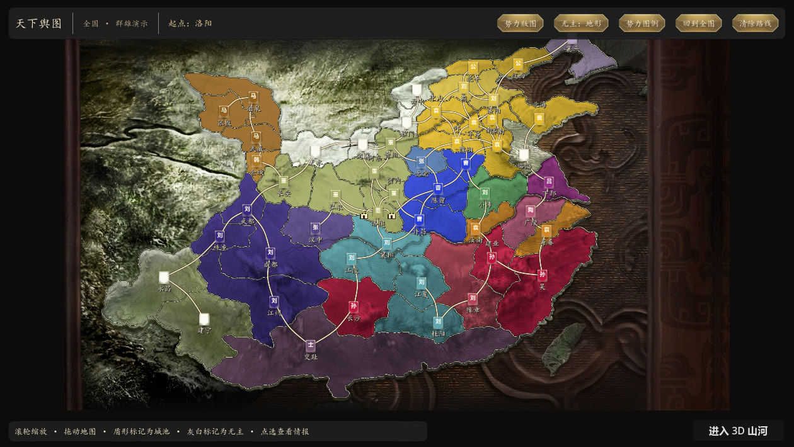

# sanguo (三国志)

当前默认进入二维全国战略地图，右上角可切换完整三维地图。自主战争首版已接入二维地图：选择目标城 → 派遣武将 → 自动配兵携粮 → 主将自主行军与作战 → 军报与复盘。模型服务在“军情 → 模型设置”中配置，未配置时使用本地人格策略。[使用、接口与验证说明](docs/自主战争首版使用与验证.md)。三维地图说明见 [current implementation](docs/full-world.md)。

## 三维参考场景 · 秋日地图

三维参考场景按参考截图布置秋日城郊：完整灰墙方城、秋色树林、道路、河岸、村落、港口和农田均已接入，可自由操作镜头。

滚轮缩放，左键/中键平移，右键环绕，WASD 移动，R 返回参考视角，Tab 隐藏界面。“完整大地图”进入 46 城全国地图，顶部“参考城郊”可返回。

已修正模型重复覆盖及贴图方向，55 个模型通过源绘制范围核对。全国地图使用 54757 株秋季树木和 38431 丛地被。局部为截图构图重建，全国城池坐标换算、道路及植被分布仍为预览配置。

[3D 实现、验证与素材说明](docs/3d-reference.md)

---

## 全国战略地图

已扩展为 1920×1080 的全国战略地图，包含 13 个州区、70 座城池、2 处关隘、96 条双向通路和 21 个演示势力。用 Godot 4.7.2 打开 `project.godot`，运行主场景即可体验。

地图使用用户提供的浮雕底图与对应的 51 块灰白地形素材。每块绑定一座控制城，其他城市归入对应分块；默认显示势力版图，颜色随控制城归属更新。分块在原尺寸画布上拼合，共用一条边界，消除各自描边造成的双线和留白。道路、城池旗标与名称由游戏绘制。

地图操作：滚轮缩放，按住鼠标左键拖动，悬停据点查看简要情报，单击查看城池详情和路线。总览保留主要城名，放大后显示全部城名和盾牌上的势力字样。再次点击已选城池，或点击“进入城市”，可进入城内。`F` 回到全图，`Esc` 清除选中与路线。

顶部“势力版图／地形舆图”切换显示方式。“无主：地形／灰白”比较两种无主区域样式：默认保留灰淡地形，灰白方案仍保留山川纹理。“势力图例”查看完整势力名称和对应颜色。势力填色依据城池归属，不按州固定着色；同州可以有多个势力，城池归属变化会刷新颜色、盾牌色带和势力名称。

城池详情包含势力、人口、经济、驻军、城防、粮草和通路。可设置行军起点并封锁或开放东侧关隘。全国地图存在绕行通路，封锁关隘阻止进入该关，不保证所有远方城池都不可达。

城内使用现有建筑与政厅系统：点击官府进入议事厅，底部内政、军事、市集、工务、民情可选命令。其他建筑支持购粮售粮、开垦、征募、操练、锻造、修建和访察。选择命令先查看消耗与结果，按“决定”执行，按“返回”取消。每项消耗 1 点行动力，每月 3 点；结束本月结算并恢复行动力。城市档案、施政记录、设置和说明采用整页 UI。

数据：`data/world_map.json` 保存全国州区、城池与通路，`data/scenario_world_demo.json` 保存归属和城务数值。`tools/assets/build_world_map.py` 是可重复生成这些数据的原始布局清单。`scripts/world/world_territories.gd` 按州区内城市构建并裁剪领地分区，`scripts/world/map_slice.gd` 绘制地图并处理相机与交互。旧局部 `map_slice.json`、`scenario_demo.json` 和旧地图美术保留供比对。

当前全国州界、城池坐标与道路属于美术布局；势力归属、城务数值与路线权重是**演示剧本**，尚未按具体历史年份校定。所有城池暂共用城景、议事厅与参议形象。

进度与最近四十条施政记录保存在 `user://city_campaign.json`。全国版保留原进度读取：原有城池沿用存档，新增城池使用剧本初值，缺少的一军备字段补为 50。

[全国地图数据与素材说明](docs/全国大地图说明.md) · [城内 UI 元素说明](docs/城内UI元素说明.md) · [大地图实现方案](docs/大地图实现方案.md)

效果图：[全图](assets/map/world-preview.png)、[无主灰白方案](assets/map/neutral-white-preview.png)、[据点情报](assets/map/world-detail-preview.png)、[盾形标记放大](assets/map/world-zoom-preview.png)、[城内](assets/city/han/game-preview.png)、[政厅](assets/city/han/council-overview.png)、[行动预览](assets/city/han/action-preview.png)。
