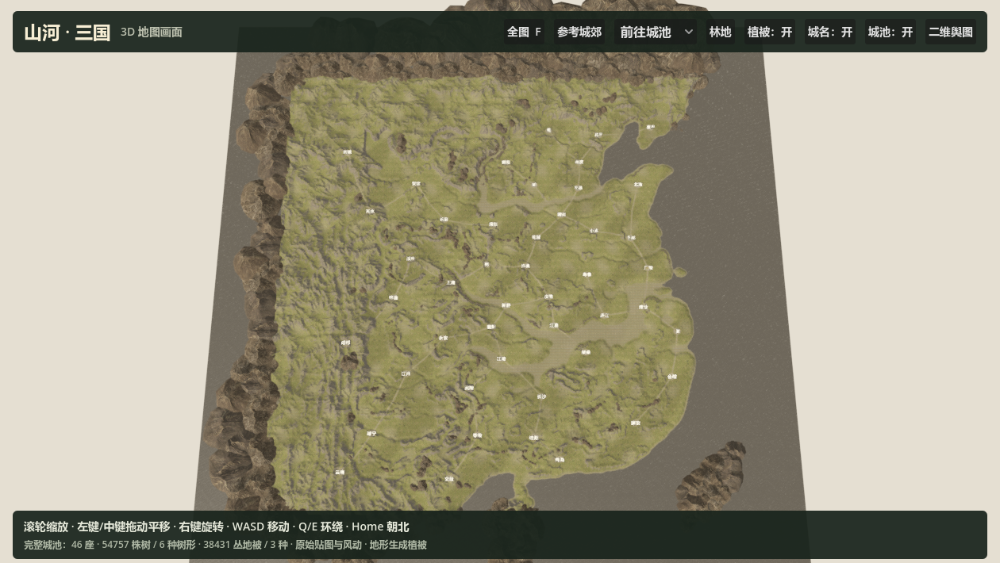
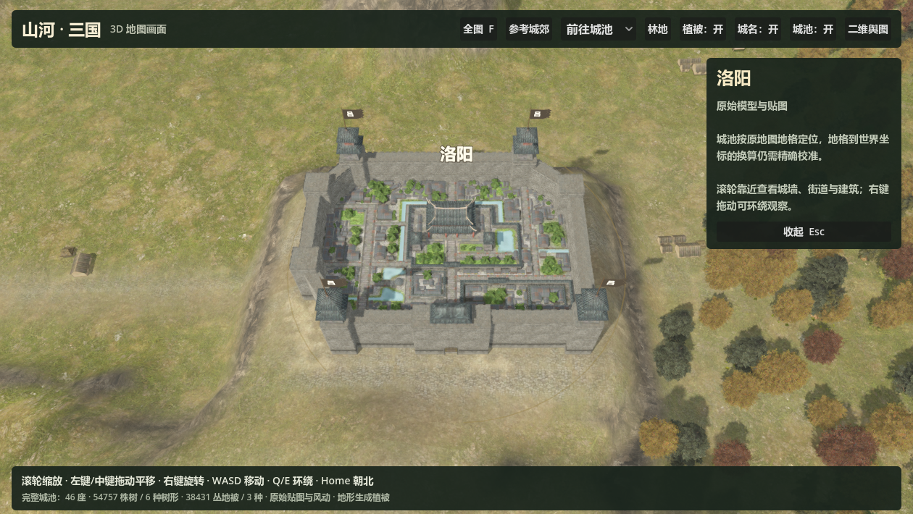

Historical local-reference notes. The current default is the complete world; see [current implementation](full-world.md). Counts and entry descriptions below describe the earlier version.

# 3D 秋日地图实现说明

运行 `project.godot` 默认进入“秋日城郊”：按用户提供的截图布置灰墙方城、秋色混交林、城外道路、河岸、港口、村落和农田。完整原始城池、秋季树木与贴图已接入，可自由移动和环绕镜头。局部地形与摆放为截图构图重建，不是原版引擎导出的完整场景。

## 操作

滚轮缩放；左键或中键拖动平移；右键拖动环绕；WASD/方向键移动；Q/E 旋转；R/Home 返回参考视角；F 查看局部总览；Tab 隐藏或显示界面。“查看城池”进入近景，“完整大地图”进入全国地图，全国地图顶部“参考城郊”可返回。

## 完整模型与材质

素材库为 55 个 GLB 模型、152 张原始颜色/法线贴图。修正了两个转换问题：Noesis 首组网格包含整个共享索引缓冲，导致建筑重复覆盖；重复翻转 V 坐标，使池塘、街道等贴图错位。现在逐组使用 G1MG 的实际索引范围、TextureID、原始 UV 和法线。

中型方城完整保留 14 组网格、7550 个三角形，首组铺地仅有 2 个三角形。`assets/rtk14/model_completeness.json` 核对全部模型的源绘制范围和材质绑定，`model_texture_links.json` 与 `texture_sources.json` 保存来源链。

金黄、红褐、深绿树木使用原始秋季素材。密林与林缘疏密不同；树木、地被避开道路、水面、农田与村落。吕字布旗为新绘制素材，旗杆根据原模型塔楼屋顶顶点放置，带轻微风动。局部包含 3 处村落、1 处港口和 3 处农田；农田垄沟、道路混合图、水面及局部地形为重建效果。

## 全国地图

全国地图保留 2049×2049 原始高度数据、64 块运行时地形、46 座完整城池。1120 条静态摆放源数据保存在 `placements.json`；预览中排除 26 处与城池占地相交的山石，防止遮住城门或穿入建筑，源数据不修改。按城池占地整平地面，原始高度文件不修改。

全国地图也使用相同的秋季材质、地表混合与风动：54757 株树、38431 丛地被。预生成数据可重现；按 128 单位分块，远处减少树木可见实例并停止投射细节阴影，地被只在近景显示。树林分布根据有效地图区域、坡度、高度、道路与城池占地生成，并非原游戏逐株坐标。

城池区域来自 `Map.bin` 地形类型 16 的七格区域，46 城名称按完整区域序列核对。地格到世界坐标的换算仍是海岸线拟合的近似值，原版公式尚未恢复；城市规模、风格配置及全国道路为预览配置。洛阳采用与参考画面一致的灰墙方城风格。全国河流水位及完整地表规则仍与原版有差异。

## 渲染与验证

使用 Godot 4.7.2 Forward+、MSAA、TAA 和叶片 Alpha 覆盖抗锯齿。局部开启环境遮蔽与间接光。雾气随镜头距离调整，避免遮住全图。已在 RTX 3060 Laptop GPU 实际渲染截图，并通过源模型绘制范围、局部布局、全国地图、镜头边界和场景往返检查。截图是运行结果。

入口为 `scenes/rtk14_reference.tscn`、`scripts/rtk14_reference.gd`；全国地图为 `scenes/rtk14_world_3d.tscn`、`scripts/rtk14_world_3d.gd`；材质为 `shaders/rtk14_*.gdshader`。

重建工具：

- `tools/build_reference_surfaces.py` 生成地表混合图、预览道路与旗帜。
- `tools/build_autumn_vegetation.py` 生成全国森林。
- `tools/convert_rtk14_models.py --source <原始提取目录>` 重建 GLB。
- `tools/validate_rtk14_models.py` 核对全部模型。

运行检查：`scripts/rtk14_reference_validation.gd`、`scripts/rtk14_world_validation.gd`、`scripts/rtk14_scene_navigation_validation.gd`。3D 画面尚未与二维城务、势力和战斗系统绑定。
