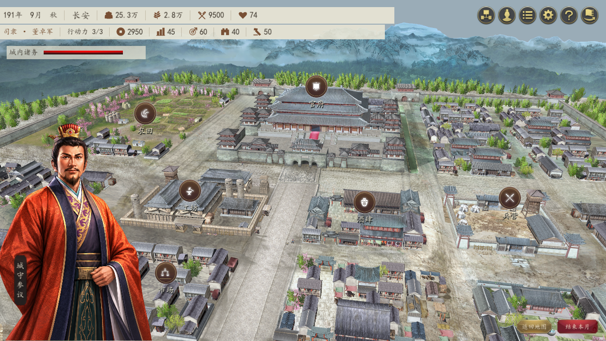
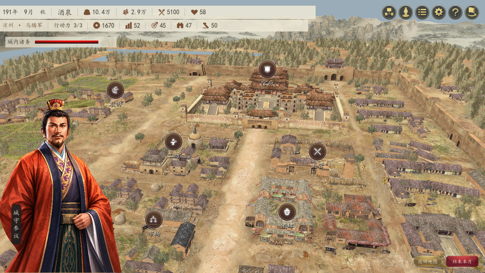
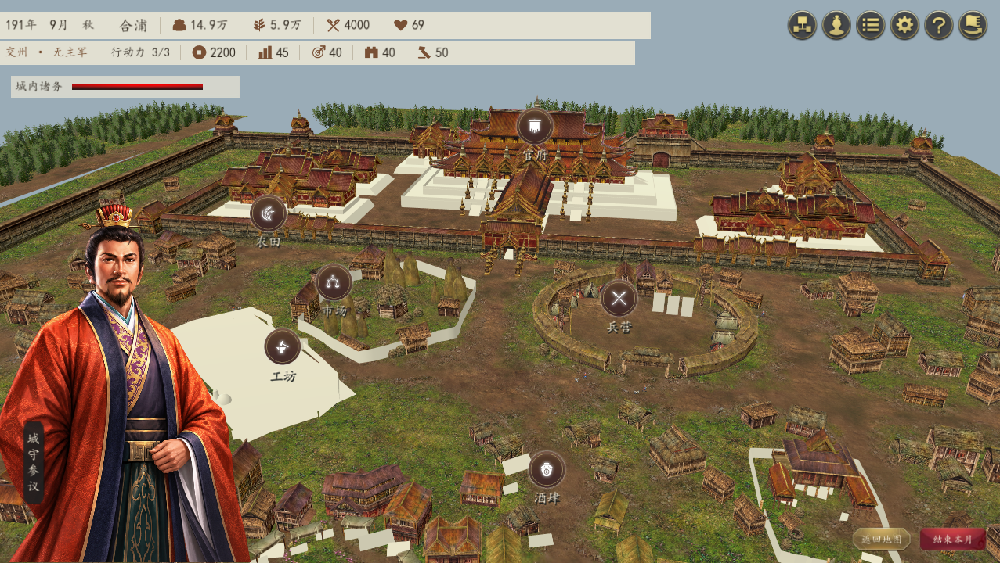
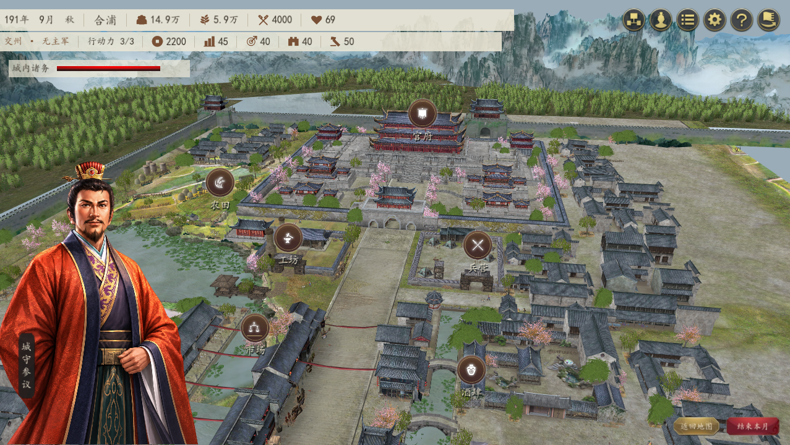

# 城池与场景逐城核对表

原始 51 城的对应已用解码后的城市表、州表逐条校验。当前地图有 70 城；长安按用户要求单独覆盖为都城布局，其他 42 城直接对应原城市、1 城使用名称别名、26 城采用明确配置的参照城。原数据用于追溯，不限制本项目的城市美术配置。

场景按城市 ID 指定，不跟随势力变更，也不按大地图州名兜底。城市外观覆盖优先于原版分类；原版五类城景允许同类城市共享布局。

## 修正前后游戏实拍

长安：此前照搬原版泛北方分类，误呈现为西凉边城；现在明确覆盖为都城式宫城、石城墙与灰瓦坊市布局。

酒泉：原来误用中原，现在参照同凉州的武威使用北方布局。

合浦：原来误用南蛮，现在参照同交州的交趾使用江南布局。

边界对比：[长安](../assets/city/comparisons/changan.png) / [洛阳](../assets/city/comparisons/luoyang.png)，[广陵](../assets/city/comparisons/guangling.png) / [下邳](../assets/city/comparisons/xiapi.png)，[成都](../assets/city/comparisons/chengdu.png) / [建宁](../assets/city/comparisons/jianning.png)。建宁缺失贴图的地台暂用纯色，仍未完整还原。

## 70 城配置

| 本项目城市 | 大地图区域 | 实际场景 | 原场景编号 | 原配置州 | 参照原城市 | 对应方式 |
| --- | --- | --- | --- | --- | --- | --- |
| 酒泉 | 凉州 | 北方 · 101 | 101 | 凉州 | 武威 · 22 | 扩展城配置 |
| 张掖 | 凉州 | 北方 · 101 | 101 | 凉州 | 武威 · 22 | 扩展城配置 |
| 武威 | 凉州 | 北方 · 101 | 101 | 凉州 | 武威 · 22 | 原城市表 |
| 金城 | 凉州 | 北方 · 101 | 101 | 凉州 | 武威 · 22 | 扩展城配置 |
| 天水 | 凉州 | 北方 · 101 | 101 | 雍州 | 天水 · 21 | 原城市表 |
| 云中 | 并州 | 北方 · 101 | 101 | 并州 | 晋阳 · 9 | 扩展城配置 |
| 雁门 | 并州 | 北方 · 101 | 101 | 并州 | 晋阳 · 9 | 扩展城配置 |
| 定襄 | 并州 | 北方 · 101 | 101 | 并州 | 晋阳 · 9 | 扩展城配置 |
| 晋阳 | 并州 | 北方 · 101 | 101 | 并州 | 晋阳 · 9 | 原城市表 |
| 上党 | 并州 | 北方 · 101 | 101 | 并州 | 上党 · 10 | 原城市表 |
| 蓟 | 幽州 | 北方 · 101 | 101 | 幽州 | 蓟 · 3 | 原城市表 |
| 渔阳 | 幽州 | 北方 · 101 | 101 | 幽州 | 蓟 · 3 | 扩展城配置 |
| 北平 | 幽州 | 北方 · 101 | 101 | 幽州 | 北平 · 2 | 原城市表 |
| 辽西 | 幽州 | 北方 · 101 | 101 | 幽州 | 北平 · 2 | 扩展城配置 |
| 襄平 | 幽州 | 北方 · 101 | 101 | 幽州 | 襄平 · 1 | 原城市表 |
| 邺 | 冀州 | 北方 · 101 | 101 | 冀州 | 邺 · 5 | 原城市表 |
| 南皮 | 冀州 | 北方 · 101 | 101 | 冀州 | 南皮 · 4 | 原城市表 |
| 平原 | 冀州 | 北方 · 101 | 101 | 冀州 | 平原 · 6 | 原城市表 |
| 中山 | 冀州 | 北方 · 101 | 101 | 冀州 | 邺 · 5 | 扩展城配置 |
| 常山 | 冀州 | 北方 · 101 | 101 | 冀州 | 邺 · 5 | 扩展城配置 |
| 济南 | 青州 | 中原 · 102 | 102 | 青州 | 济南 · 8 | 原城市表 |
| 北海 | 青州 | 中原 · 102 | 102 | 青州 | 北海 · 7 | 原城市表 |
| 东莱 | 青州 | 中原 · 102 | 102 | 青州 | 北海 · 7 | 扩展城配置 |
| 临淄 | 青州 | 中原 · 102 | 102 | 青州 | 北海 · 7 | 扩展城配置 |
| 长安 | 司隶 | 中原 · 102 | 101 | 雍州 | 长安 · 20 | 城市外观覆盖 |
| 弘农 | 司隶 | 中原 · 102 | 102 | 司隶 | 弘农 · 19 | 原城市表 |
| 洛阳 | 司隶 | 中原 · 102 | 102 | 司隶 | 洛阳 · 18 | 原城市表 |
| 河东 | 司隶 | 中原 · 102 | 102 | 司隶 | 弘农 · 19 | 扩展城配置 |
| 河内 | 司隶 | 中原 · 102 | 102 | 司隶 | 洛阳 · 18 | 扩展城配置 |
| 陈留 | 兖州 | 中原 · 102 | 102 | 兖州 | 陈留 · 14 | 原城市表 |
| 濮阳 | 兖州 | 中原 · 102 | 102 | 兖州 | 濮阳 · 13 | 原城市表 |
| 定陶 | 兖州 | 中原 · 102 | 102 | 兖州 | 陈留 · 14 | 扩展城配置 |
| 山阳 | 兖州 | 中原 · 102 | 102 | 兖州 | 陈留 · 14 | 扩展城配置 |
| 小沛 | 徐州 | 中原 · 102 | 102 | 徐州 | 小沛 · 12 | 原城市表 |
| 下邳 | 徐州 | 中原 · 102 | 102 | 徐州 | 下邳 · 11 | 原城市表 |
| 琅琊 | 徐州 | 中原 · 102 | 102 | 徐州 | 下邳 · 11 | 扩展城配置 |
| 广陵 | 徐州 | 江南 · 103 | 103 | 扬北 | 广陵 · 23 | 原城市表 |
| 许昌 | 豫州 | 中原 · 102 | 102 | 豫州 | 许昌 · 15 | 原城市表 |
| 谯 | 豫州 | 中原 · 102 | 102 | 豫州 | 谯 · 16 | 原城市表 |
| 汝南 | 豫州 | 中原 · 102 | 102 | 豫州 | 汝南 · 17 | 原城市表 |
| 颍川 | 豫州 | 中原 · 102 | 102 | 豫州 | 许昌 · 15 | 扩展城配置 |
| 沛国 | 豫州 | 中原 · 102 | 102 | 豫州 | 谯 · 16 | 扩展城配置 |
| 武都 | 益州 | 西蜀 · 104 | 104 | 益州 | 武都 · 26 | 原城市表 |
| 汉中 | 益州 | 西蜀 · 104 | 104 | 益州 | 汉中 · 25 | 原城市表 |
| 梓潼 | 益州 | 西蜀 · 104 | 104 | 益州 | 梓潼 · 29 | 原城市表 |
| 成都 | 益州 | 西蜀 · 104 | 104 | 益州 | 成都 · 27 | 原城市表 |
| 巴西 | 益州 | 西蜀 · 104 | 104 | 益州 | 梓潼 · 29 | 扩展城配置 |
| 江州 | 益州 | 西蜀 · 104 | 104 | 益州 | 江州 · 30 | 原城市表 |
| 越嶲 | 益州 | 南蛮 · 105 | 105 | 南中 | 建宁 · 49 | 扩展城配置 |
| 永昌 | 益州 | 南蛮 · 105 | 105 | 南中 | 永昌 · 31 | 原城市表 |
| 建宁 | 益州 | 南蛮 · 105 | 105 | 南中 | 建宁 · 49 | 原城市表 |
| 襄阳 | 荆州 | 江南 · 103 | 103 | 荆北 | 襄阳 · 34 | 原城市表 |
| 江陵 | 荆州 | 江南 · 103 | 103 | 荆南 | 江陵 · 37 | 原城市表 |
| 江夏 | 荆州 | 江南 · 103 | 103 | 荆北 | 江夏 · 35 | 原城市表 |
| 长沙 | 荆州 | 江南 · 103 | 103 | 荆南 | 长沙 · 38 | 原城市表 |
| 零陵 | 荆州 | 江南 · 103 | 103 | 荆南 | 零陵 · 39 | 原城市表 |
| 桂阳 | 荆州 | 江南 · 103 | 103 | 荆南 | 桂阳 · 41 | 原城市表 |
| 武陵 | 荆州 | 江南 · 103 | 103 | 荆南 | 武陵 · 40 | 原城市表 |
| 寿春 | 扬州 | 江南 · 103 | 103 | 扬北 | 寿春 · 42 | 原城市表 |
| 建业 | 扬州 | 江南 · 103 | 103 | 扬南 | 秣陵 · 44 | 名称别名 |
| 吴 | 扬州 | 江南 · 103 | 103 | 扬南 | 吴 · 45 | 原城市表 |
| 会稽 | 扬州 | 江南 · 103 | 103 | 扬南 | 会稽 · 46 | 原城市表 |
| 柴桑 | 扬州 | 江南 · 103 | 103 | 扬南 | 柴桑 · 47 | 原城市表 |
| 豫章 | 扬州 | 江南 · 103 | 103 | 扬南 | 鄱阳 · 48 | 扩展城配置 |
| 庐江 | 扬州 | 江南 · 103 | 103 | 扬北 | 庐江 · 43 | 原城市表 |
| 建安 | 扬州 | 江南 · 103 | 103 | 扬南 | 会稽 · 46 | 扩展城配置 |
| 交趾 | 交州 | 江南 · 103 | 103 | 交州 | 交趾 · 51 | 原城市表 |
| 合浦 | 交州 | 江南 · 103 | 103 | 交州 | 交趾 · 51 | 扩展城配置 |
| 苍梧 | 交州 | 江南 · 103 | 103 | 交州 | 交趾 · 51 | 扩展城配置 |
| 南海 | 交州 | 江南 · 103 | 103 | 交州 | 交趾 · 51 | 扩展城配置 |
