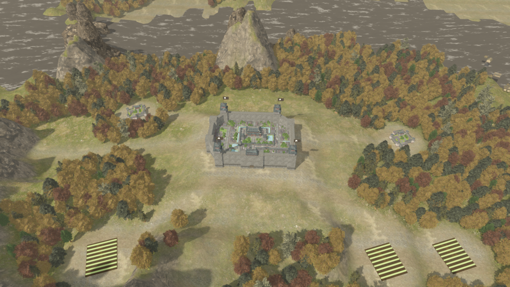
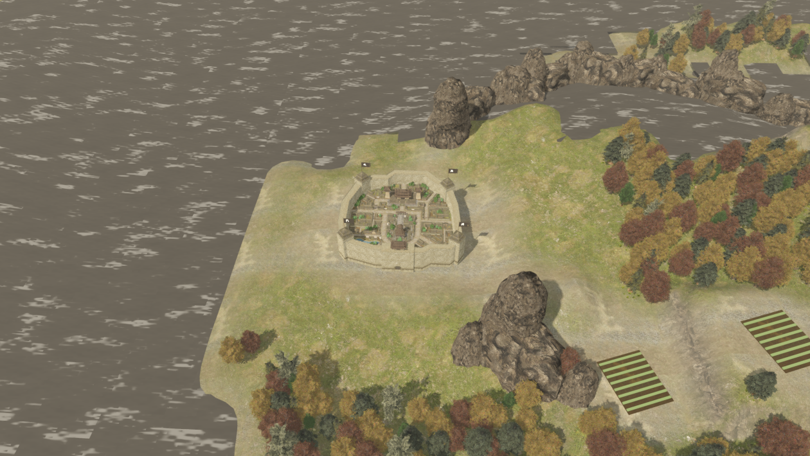
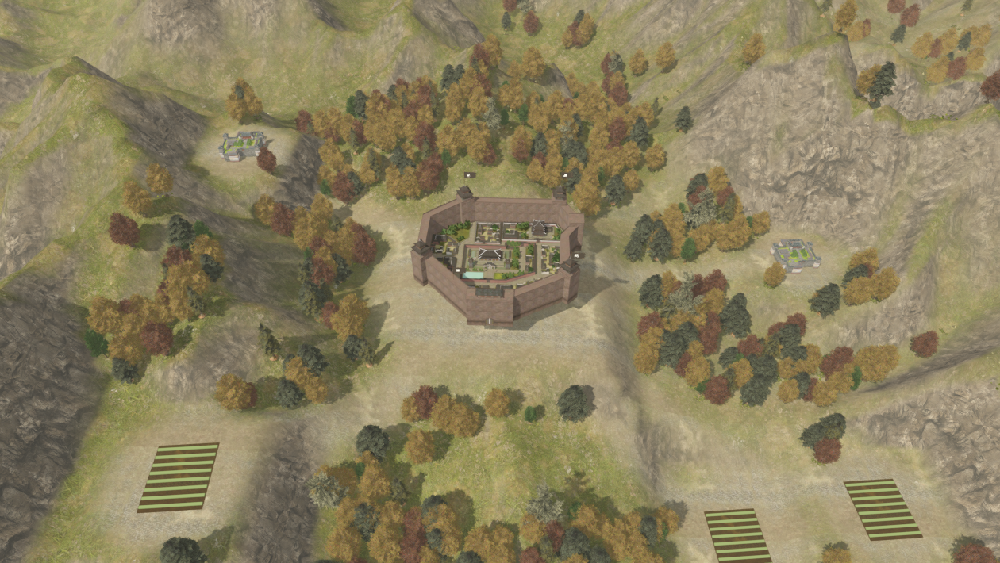
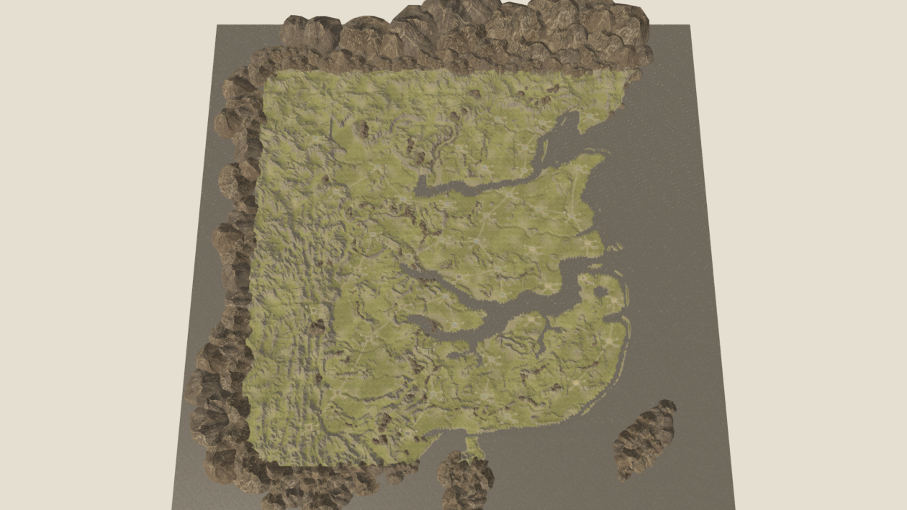

Current accuracy and fixes: [remake status](rtk14-remake-status.md). Earlier counts below include stripe farms which are now removed, and the project entry may be the existing 2D map. Run scenes/rtk14_world_3d.tscn directly for 3D.

# 全地图秋日效果

项目默认进入完整地图 `scenes/rtk14_world_3d.tscn`。从洛阳开始，可以连续移动镜头，通过城市列表跳转全部 46 座城。地表、秋色植被、光照、环境遮蔽和水面采用全图共享规则。

全图包含 64 块地形（2 单位网格）、46 座完整城池、150900 株树、105346 丛地被，以及覆盖全部城市的 217 处村落和农田。55 个原始模型和 152 张贴图沿用。黄河、长江、支流和湖泊根据原地图水域地格生成，河面沿谷地调整高度。

滚轮缩放，左键或中键平移，右键环绕，WASD 移动，Q/E 旋转。F 查看全国，Home 返回洛阳，Tab 隐藏界面。

地格坐标仍是近似换算，城市样式及植被、道路、聚落为重建配置。河岸和地表质感仍与参考图有差异，尚非原版一比一还原。

重建数据：依次运行 `tools/assets/build_world_landscape.py` 和 `tools/assets/build_autumn_vegetation.py`，再在 Godot 导入。原始高度文件不修改。

验证：`tests/world/rtk14_world_validation.gd` 检查全国地形、46 城覆盖、河流、植被及镜头；`tools/validate/validate_rtk14_models.py` 核对源网格和贴图。建业和成都实际截图约 76、50 帧，视角不同会影响性能。
