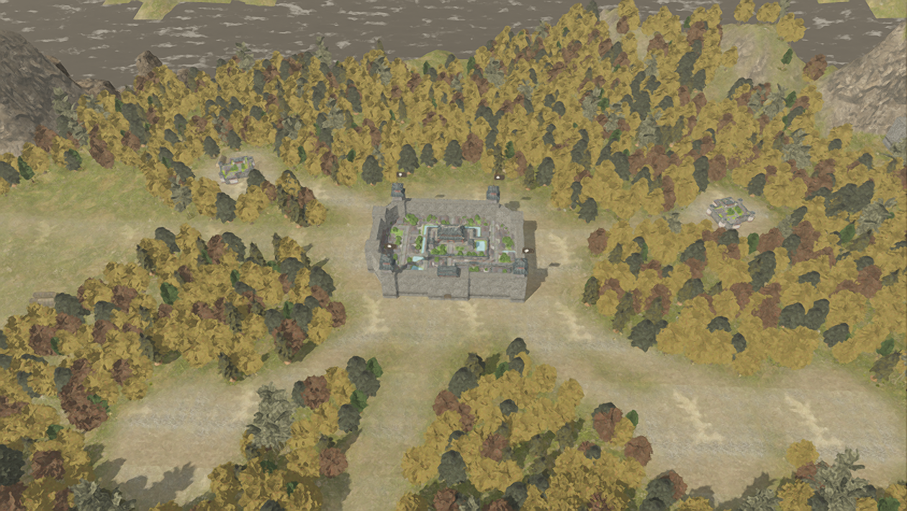
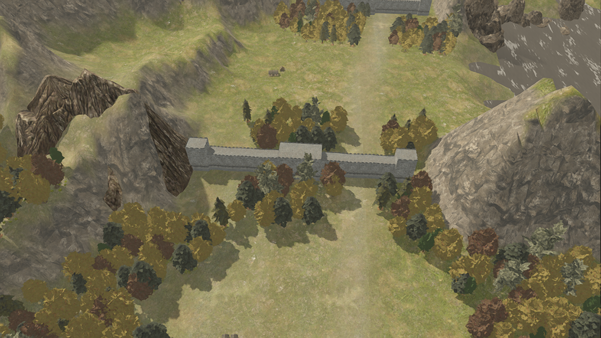
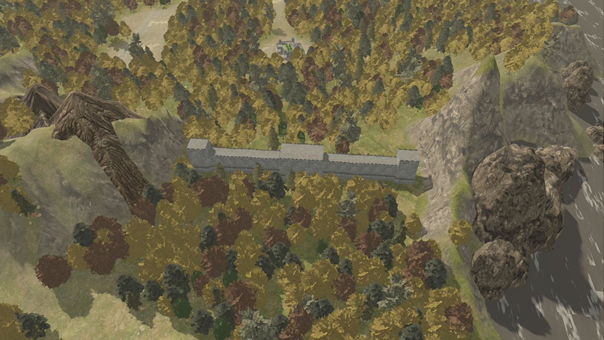

# 城池、关口与地形坐标校准

此页保留坐标校准过程；植被和地表派生规则后来已替换为来源数据。当前状态与性能见 [原版全地图数据恢复](native-landscape-recovery.md)，下列旧植被数量和帧率不代表当前版本。地格转换仍为估计值。

上一轮修正了高度和缩放，但平面位置仍使用海岸拟合公式：`x=250+7.5*column`、`z=160+8*(row+0.5*odd_column)`。静态山体使用原始世界坐标，两套数据因此错位。只调整 Y 或削平地面无法解决关口落在山顶的问题。

本次用原始高度图中的河谷、城市地格平坦度和山地区域共同校准转换，统一到 `assets/rtk14/grid_transform.json`。46 城、10 关口、河流掩码、地表混合图、聚落和植被生成都使用同一个转换。原始地格编号、高度图、模型和静态 X/Z 摆放不修改。

| 检查 | 旧坐标 | 新坐标 |
| --- | --- | --- |
| 城市地格平均坡度 | 0.393 | 0.041 |
| 城池占地冲突而被过滤的山石 | 26 条 | 0 条 |
| 保留的原始静态摆放 | 1094 条 | 1120 条 |
| 关口 304 原始地面平均高度 | 39.50 | 7.66 |
| 关口 318 原始地面平均高度 | 33.87 | 7.68 |

城市坡度用于拟合，不能作为独立的正确性证明；山石占地冲突和关口落点提供额外检查。洛阳附近的关口 131、132 已在实际渲染截图中检查：墙体位于两侧山体之间的通道，而非山顶。编号保留来源区域信息，未把原版关口名称强行对应。

这次是全地图坐标校准，不是手工只移动洛阳附近两个模型。不过原版运行时常量仍未恢复，转换依旧应标记为估计值，不能宣布逐格 1:1 已完成。关口朝向、动态建筑样式、道路和植被生成规则也有未还原部分。

验证：`tests/world/rtk14_world_validation.gd` 检查全部城池、关口的坐标能从来源地格和共享转换重算，全部 1120 条静态摆放保留；近远景植被数量固定及性能批处理检查继续通过。本次重新生成植被后数量为 154048 棵树、107593 处地被，运行时缩放不增减。

校准后性能重测（1260×710、流畅模式）：洛阳近景两轮约 124 FPS、146 次可见绘制；全国总览约 164 FPS。数据见 `validation/performance-aligned.json`，仍受同机负载影响。

运行 `scenes/rtk14_world_3d.tscn` 加载新数据。旧的运行窗口需要重新运行场景。

