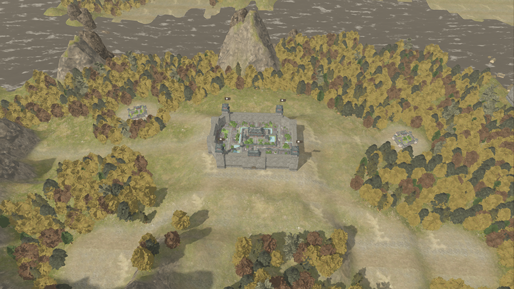
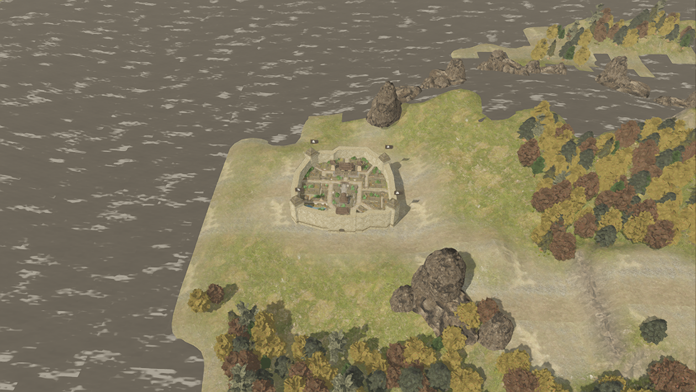
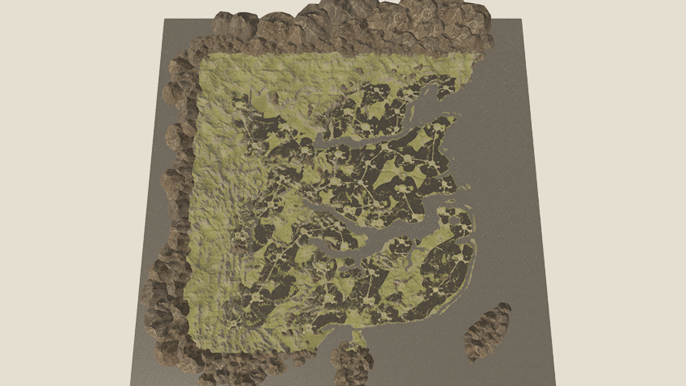
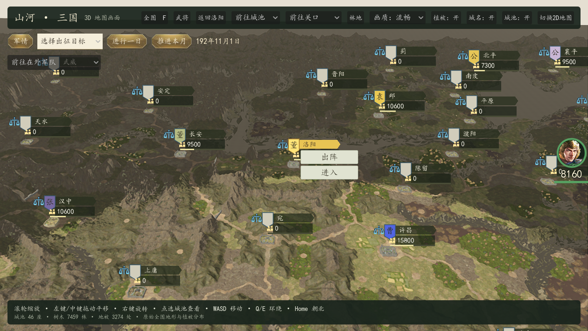

# 山石核对与地图性能

此页记录前期性能优化。最新版本已使用原版地表和植被分布，并减少城市标记重绘，见 [原版全地图数据恢复](native-landscape-recovery.md)。当前实际更新下性能报告为 `validation/performance-native-world.json`；以下旧测量和数量属于历史版本。

本次核对原始模型和贴图来源、1120 条静态摆放、地形高度、变换矩阵，以及植被的绘制开销。项目还不是原版 1:1，地表与动态摆放的还原差异见 `rtk14-remake-status.md`。

## 山石修正

原地形与派生地形对比，在地图内 866 条山体/崖壁记录中，295 处脚下地面高度改变超过 0.25 单位，最大差约 16 单位。之前物件高度没有随整地和河床调整同步，产生悬空、突兀和穿插。

运行时保持原始 X/Z、旋转与缩放，在 Y 上补偿“当前地形高度减原地形高度”，保留物件原本相对地面的偏移。原始高度及摆放 JSON 不修改。非均匀缩放改为旋转后的局部缩放，避免世界轴缩放造成变形。此落地补偿是针对派生地形的修正，不代表已经恢复原版全部坐标。

## 性能优化

- 植被的原始网格与 UV 保留，多个材质分组合并为单表面，使用 13 层颜色/法线纹理数组；同一视角绘制提交由 774 次降至约 174 次。
- 树木和地被位置与数量保持固定。模型与地形使用网格 LOD，植被仍分块进行视野裁剪。
- 镜头距离超过 650 时，切换到 9 个远景植被批次。远景图由各原始模型和贴图以俯视角烘焙，仍使用同一份 150890 棵树、105337 处地被坐标，不随机增减数量。首次运行生成缓存，以后复用；近景仍显示原始网格。
- 默认“画质：流畅”：3D 内部使用 67% 分辨率，FSR 放大，保留 TAA，关闭重复 MSAA 与 SSIL，缩短远处阴影距离。
- “画质：精细”使用原生分辨率和 SSIL；切换不改变植被摆放。

1260×710 洛阳视角，本次初始测试约 14–21 帧，优化后较高负载时约 28–45 帧，建业截图约 54 帧。最终重复性能测试近景约 143 帧（GPU 6.4 ms、175 次可见绘制），全国总览约 165 帧（GPU 2.1 ms），距离 700 的远景切换视角约 165 帧（GPU 3.1 ms）。总览实际截图时约 121 帧。测试期间显卡时钟与其他窗口负载存在明显波动，因此不能把不同时间的帧率直接作为固定倍数提升，也不是稳定帧率保证。精细模式仍会更耗性能。

详细数据：`validation/performance-before.json`、`validation/performance-optimized.json`、最终重复测量 `validation/performance-current.json`。`tools/validate/rtk14_performance_check.gd` 可重测近景、总览、远景切换及重复近景的帧时间、CPU/GPU 渲染时间、绘制提交和阴影几何数量。175 次提交仅指洛阳近景；总览同时显示更多地形、山石和建筑，提交数不同。

验证通过：55 模型源网格及贴图检查；46 城、10 关口；植被缩放数量固定；合并前后顶点/索引数量及 13 层贴图绑定检查；山石变换无额外剪切；两档画质切换。

实现依据：Godot [Basis 的局部缩放](https://docs.godotengine.org/en/stable/classes/class_basis.html#class-basis-method-scaled-local)、[网格 LOD](https://docs.godotengine.org/en/stable/tutorials/3d/mesh_lod.html) 和 [Viewport 的分辨率缩放](https://docs.godotengine.org/en/stable/classes/class_viewport.html#class-viewport-property-scaling-3d-scale)。
