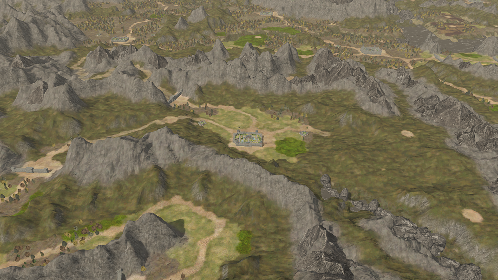
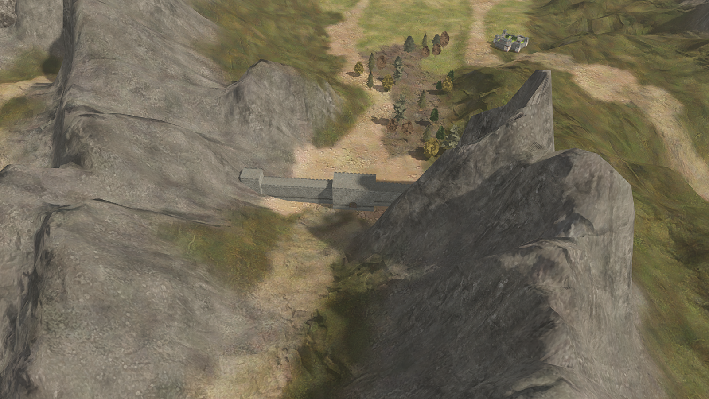
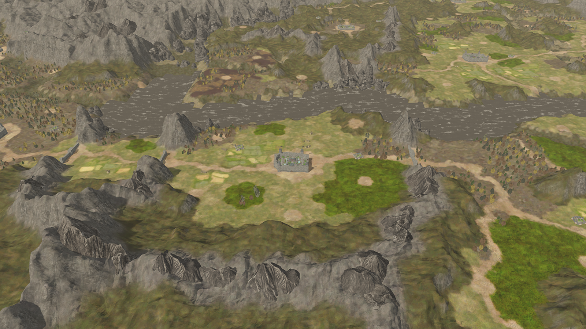
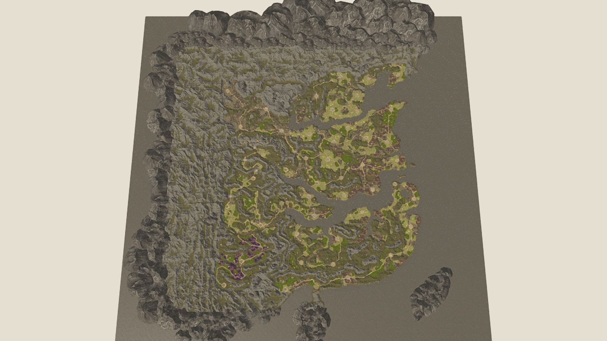

# 原始全图地表与关口地基修正

此页保留前期记录。最新版本已恢复准确的 18 项材质映射、三套数组、原版植被分布和来源高度，见 [原版全地图数据恢复](native-landscape-recovery.md)；本页旧数量和生成规则不代表当前版本。

模型贴图此前已有，但地表漏掉了原地图的整图材质和纹理数组。旧地表用生成混合图、草地与山石模型的局部贴图组合，导致碎石重复、林地和裸地分布不符合原图。此次替换应用于全部 64 个地形块。

## 地表来源与接入

`field-textures/239167e0.g1t` 含 2049×2049 原始高度和控制图、4096×4096 全图颜色、法线及参数图。提取时逐点检查其高度与项目 `heightmap.r32` 完全一致，避免材质与不同版本的地形错位。整图颜色、法线直接按全地图坐标采样，保留原始裸地、林地地表、道路和田地分布；不再用生成的 `world_splat.png` 作为地表材质。生成混合图仍供旧植被回退逻辑读取。

`field-textures/57ee6cea.g1t` 有三组 19 层地形纹理。普通单 DDS 导出只得到首层，遗漏其余层。数组实际按 mip 大小分组：先连续存放 19 张 1024 图，再存放 19 张 512 图，依次到 4 图。新提取器恢复全部 57 张原始图，颜色与法线另保留原始 BC3 数据，直接创建两个有 mipmap 的 Godot 纹理数组。原始网格及源贴图文件不修改。

近景通过原控制图 B 通道选取细节层，补上全图低分辨率烘焙缺少的频率，远景淡出细节采样。地形类别和数组层的对应根据原始全图颜色核对，未出现的类别不猜测，沿用全图颜色。重复尺度 60、近景混合、陡坡投影及岩石色彩参数仍属于重建设置；尚未恢复原版运行时着色器。岩石色彩遮罩在原岩面类别边界平滑，避免直接使用整数类别造成灰绿交界的阶梯。所有原控制通道与参数图均保留，当前只使用 B 通道索引。

两个 19 层 BC3 数组合计约 50.7 MiB；只把所需控制通道作为 L8 上传，较 RGBA 控制图少约 12 MiB。颜色和法线整图也使用显存压缩及 mipmap，防止近远景纹理闪烁。未使用的导出参数层不在运行时加载。

重建：运行 `tools/extract_rtk14_terrain.py --source <rtk14-assets目录>`，随后 Godot 导入。原始包哈希与角色记录见 `assets/rtk14/terrain/manifest.json`。

## 关口为何像在坑里

旧代码以关口中心高度压平周围直径约 40 的圆形区域，遇到两侧山坡会向下削出平底洼地。现改为按旋转后的墙体窄占地处理，只补墙脚空隙，过渡不超过 3，任何关口都不再降低周围高度。墙体宽度根据原始类型 17 地格占地估计，保留完整源网格，避免依靠扩大挖山范围安放模型。

关口 X/Z 仍为来源地格的中心。朝向、模型尺度和地格转换属于有来源的估计，未确认原版运行时参数。山谷两侧包住墙端是关口与山地衔接；此前被挖出的圆坑已取消。

## 检查与性能

`scripts/rtk14_world_validation.gd` 检查 10 个关口原先挖坑范围：高度不得低于保存的地形，墙脚过渡范围外高度必须保持一致；同时核对原始地格中心、模型占地、4096 整图、19 层 BC3 及 mipmap。46 城、1120 条静态摆放、64 地形块和缩放时固定植被数量检查通过。当前运行显示 12442 棵树、4389 处地被。

本轮实际相机及 UI 更新开启，1260×710 流畅模式最终测量：洛阳约 145 帧，重复约 169 帧，GPU 时间 5.5–6.3 ms；全国约 337 帧，距离 700 约 237 帧。报告 `validation/performance-native-terrain.json`。本轮较早一次测量仅为洛阳 112–113 帧、全国约 167 帧，说明同机负载与短时测量会明显波动。测试关闭帧率同步、每个视角取 45 帧的中位数，不能直接计算与先前测量的提升倍数，也不代表更高分辨率或精细模式能保持同样帧率。

实际运行截图（1600×1000，流畅模式）：

原始地表贴图已接入全地图，但植被摆放、部分建筑配置、精确地格转换、水面以及原版光照着色仍未完全恢复。此次修正不等于原作 1:1 完成。
