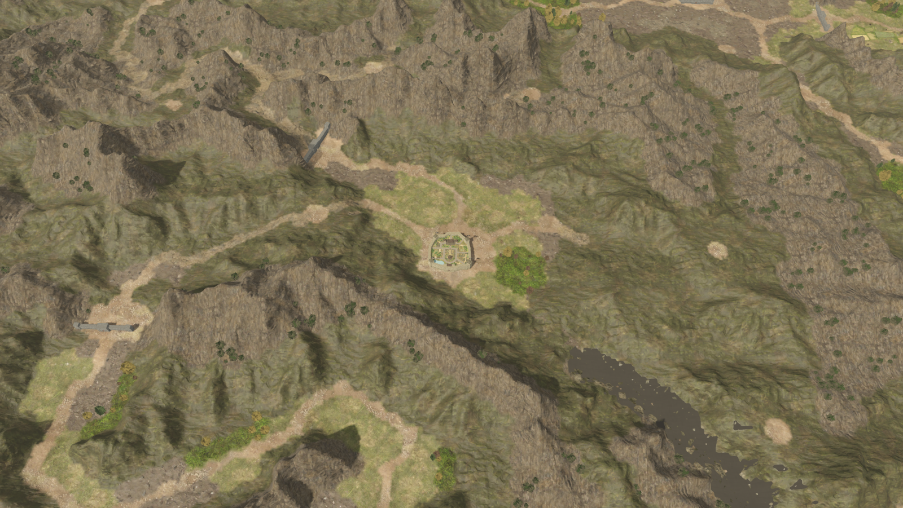
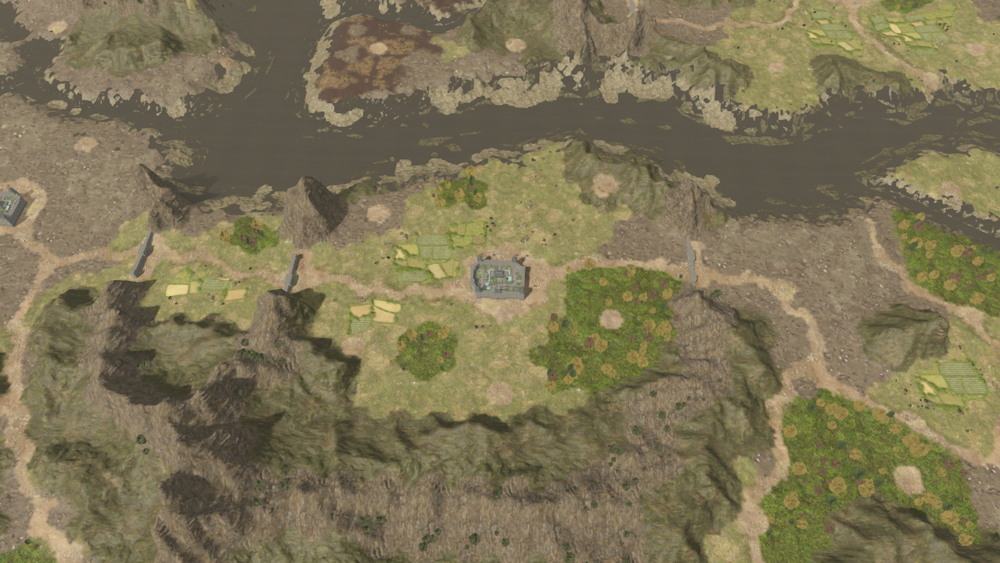
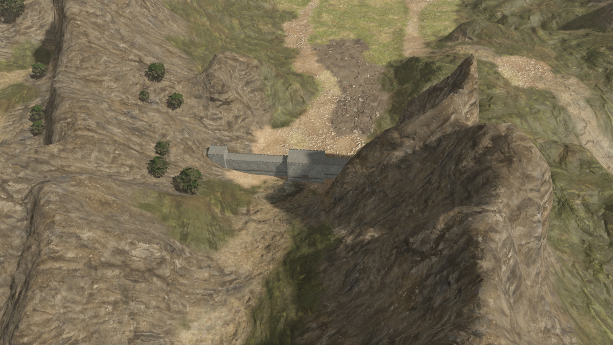
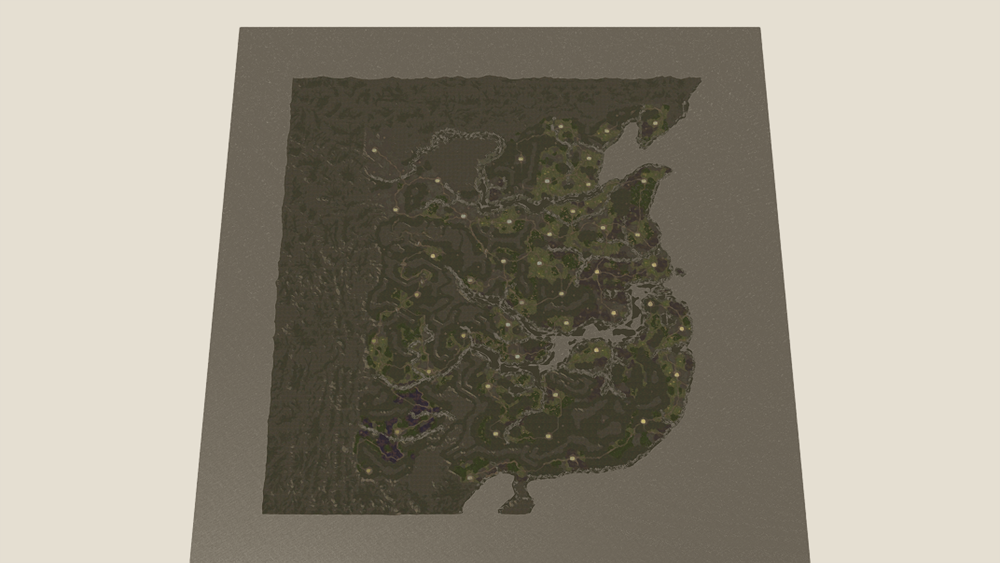

# 三国志14地图还原状态

当前版本仍是使用原始素材的重建场景，尚未达到 1:1。全地图范围与原作准确还原是两项不同的验证，不能用城市数量、植被数量或者全国截图代替准确性验证。

最新恢复记录见 [原版全地图数据恢复](native-landscape-recovery.md)：已恢复原始高度、地表控制、18 项材质的准确数组映射和纹理周期、三套 19 层材质数组，以及全地图原版植被分布图。另接入原始双层水面法线和全图一米采样河流缓存。现已恢复全部 1120 个静态摆放；山体接入后的性能实测约为洛阳流畅 278 FPS、精细 203 FPS、全国总览 131 FPS。

植被不再依据宽泛地形类型和围城规则生成，改用原版 1024² 生境图、来源树种、缩放区间和随机种子。运行时约 7459 棵树、3274 处地被，14 种模型合并为 19 层贴图数组。缩放保持同一批位置；逐株随机算法尚未还原。山体恢复原始切线，补入材质参数图，并修正法线横向的叉积方向。

最新坐标修正见 [城池、关口与地形坐标校准](map-coordinate-check.md)：已替换旧海岸拟合，统一全部派生层的地格转换，并实拍核对洛阳城池及两侧关口。静态摆放的位置、旋转和缩放来自原场景；地格转换仍是根据原始地形特征校准的估计值。

前期修正：取消按距离改变植被实例数量，保留固定位置，通过原模型的网格细节级别优化远景；批次由 128 缩到 64 单位，改善视野裁剪。临时生成的条纹农田不再绘制。添加 10 处原始关口模型，来源为 `Map.bin` 的 42 个类型 17 地格，保留来源索引；关口可从列表跳转。墙脚仅补空隙，植被避开模型范围。

## 数据准确性

| 部分 | 当前依据 | 未完成项 |
| --- | --- | --- |
| 山体与静态物件 | 原场景 1120 个摆放全部绘制：105 个显式可见村落，加上 1015 个继承默认显示状态的山体、峭壁等物件；保留来源变换。地形 DXBC 含细分高度位移阶段 | 关口/村落与原始地格的精确转换、运行时可见性覆盖、细分常量和环境渲染仍未全部恢复 |
| 城池 | 原始网格、UV、贴图和七格区域 | 地格转换公式、原作样式选择和城市阶段配置未恢复 |
| 关口 | 原始模型、原地图地格、共享地形校准转换 | 精确运行时转换未确认，朝向与尺度根据占地推算，名称未映射 |
| 植被 | 原始分布图、密度图、27 个元素参数、14 类生境、模型引用和缩放区间 | PRNG、密度单位、季节转换；逐株位置仍由重建采样器生成 |
| 河流 | 原始水域控制；来源双层法线、SWATER 解码；50 个一米采样分块及网格缓存 | 原始河流控制点、水位、流向、纹理周期、反射环境与材质常量未恢复 |
| 地表、道路、村落 | 原始控制图、三套材质数组、准确的 18 项材质映射及纹理周期；105 处原始静态村落 | 完整原版 BRDF、细分位移、坡面及近远混合常量绑定 |

因此不能把当前结果称为完整的 1:1 复刻。后续准确还原必须替换上述拟合和生成数据；不应继续靠新增随机树木、临时农田或复制构图冒充原版。

## 验证

`scripts/rtk14_world_validation.gd` 验证 46 城、10 关口、1120 个原场景摆放、源地格来源、关口镜头和近远镜头植被实例数量不变。六角格交互线默认隐藏，可按 G 临时查看。`tools/build_source_gates.py` 可重建关口清单。

原始高度缓存与来源逐字节相同；运行时城市和关口仍有局部地基处理。原始高度、地表控制、植被分布与密度的独立来源检查见 `validation/native-source-map-check.json`。58 个模型的来源绘制范围与颜色贴图绑定检查通过。

新增 `tools/validate_rtk14_water.py`：两张水面法线共 524288 个像素与原始 G1T 完全一致；50 个分块的 448797 个顶点高度与水位缓存一致，809140 个三角形均为一米格的一半。水位缓存本身仍为重建值，检查不证明水位与原作一致。最终场景检查日志为 `validation/native-water-validation.log`。

打开 `scenes/rtk14_world_3d.tscn` 可直接运行这张 3D 地图。已有 2D 项目入口沿用当前项目配置；在 3D 顶部“前往关口”可查看 10 处关口，暂按原始区域编号显示。

性能检查开启正常地图更新，使用 RTX 3060 Laptop、Vulkan、1260×710 和流畅模式。植被使用空间合批和固定位置的近远表现切换；静态摆件按 256 米块合批以便视锥裁剪；六角格线默认关闭，需要时按 G 打开。含静态摆件时近景流畅中位 3.592 ms（278 FPS）、精细 4.916 ms（203 FPS）、全国总览 7.625 ms（131 FPS）；详见 `validation/performance-native-static.json`。样本仍受同机负载影响。

最新一米地形和水面版本：洛阳流畅两轮约 264/311 FPS，精细约 197 FPS，全国流畅约 245 FPS。每视角仅采样 45 帧，不能代表长期稳定帧率。地形与河流分别复用全部 64/50 块缓存。主场景保留同时开发的战役 UI；拍照模式递归隐藏界面。
