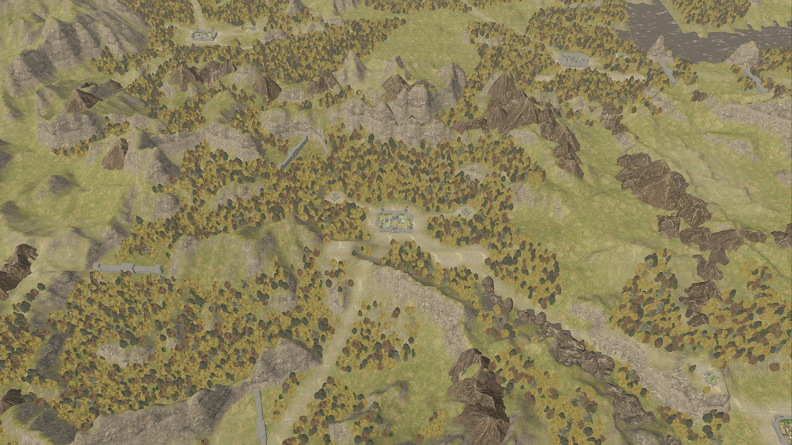
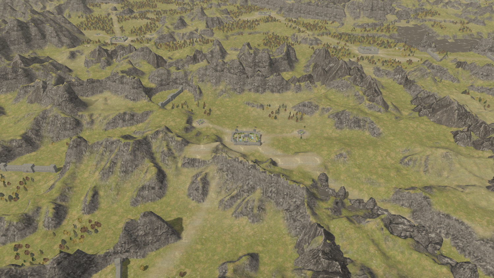
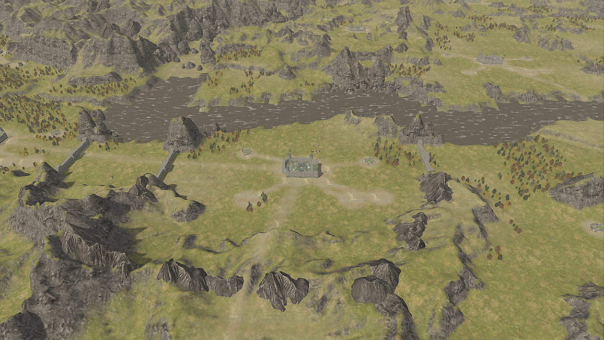

# 按汉中参考图调整植被与山体

此页保留前期记录。当前已使用原版植被生境图，运行时约 7459 棵树、3274 处地被，并恢复山体来源切线；此页灰化和植被生成规则已被替换。见 [原版全地图数据恢复](native-landscape-recovery.md) 和 `validation/performance-native-world.json`。

参考图中的汉中以裸露的山脊、开阔谷地和零散小树丛为主。此前生成规则允许大多数平地、坡地种树，并额外在每座城周围增加森林环，形成过密的大块树冠。

本次调整应用于整个地图：

- 去除围城森林与广域随机森林覆盖；主要树丛限制在选定来源地格，并通过小片分布重建。地格解释与生成规则仍属于预览，不是已恢复的原版植被算法。
- 树木间距由 2.1 增至 3.5；树模型缩放由 0.30–0.46 改为 0.20–0.30；只在较平缓地面种植，城池半径 24 内留白。
- 原始生成树木由 154074 棵改为 12442 棵，地被由 107611 处改为 4389 处。运行时关口占地过滤后为 12440 棵树、4389 处地被。汉中半径 100 范围只有 60 棵树。镜头缩放仍使用固定摆放集合。
- 取消城池附近半径 52 的广域地形平滑，保留原始起伏；建筑地基及重建河床仍有局部处理。派生高度图约 88.4% 样点与原始高度相同。
- 坡面使用原始岩石颜色及法线纹理，山石原始材质在运行时调整为较中性的灰色。原始网格、UV、贴图文件、模型缩放与静态 X/Z 坐标不修改。
- 地区镜头改为距离 240、俯角 35 度；阴影范围随镜头距离调整，避免拉远后山壁丢失阴影。全国总览仍限制阴影开销。

检查通过：46 座城、10 个关口、1120 条静态摆放保留；山石渲染副本的顶点、索引和贴图来源与原模型一致；近远景植被数量固定。1260×710 流畅模式固定场景测量约 96 帧，总览约 170 帧，数据见 `validation/performance-sparse.json`。这是比此前距离 85 更广的视角，帧率不宜直接当作同视角提升比例。

正常更新相机与 UI 的重测波动很大，地区视角约 11–22 帧、总览约 69 帧，见 `validation/performance-sparse-live.json`。测试机同时运行原版游戏和另一个 Godot 窗口，测试结束后的显卡读数仍为 100% 使用率；系统内存余量也较小。第一次重测出现 `std::bad_alloc`，后续重测完成，因此性能与内存稳定性不能仅凭固定场景的 96 帧下结论。已避免静止时重复提交相机变换、标签尺寸和阴影范围，但当前负载下仍不能保证稳定 60 帧。启动后立刻截屏的帧率受加载和编译影响，后续截图不再把它当作性能结果输出。

下面的前后截图也调整了镜头。它们用于展示画面构成，不是同相机参数的性能对比。

山体现在有更多裸岩与明暗细节，但参考图中更陡的山壁比例、山石与地形的衔接仍有差异。当前未完成原版地形渲染参数和逐株植被规则的恢复，不能把这轮调整称为 1:1 完成。
