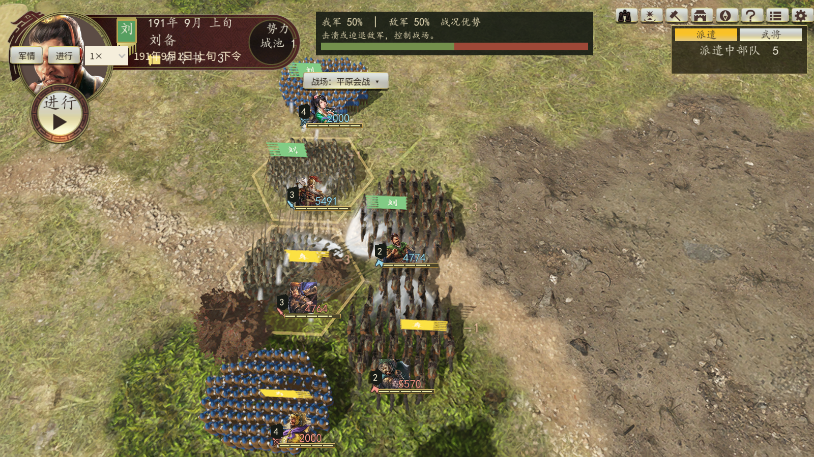
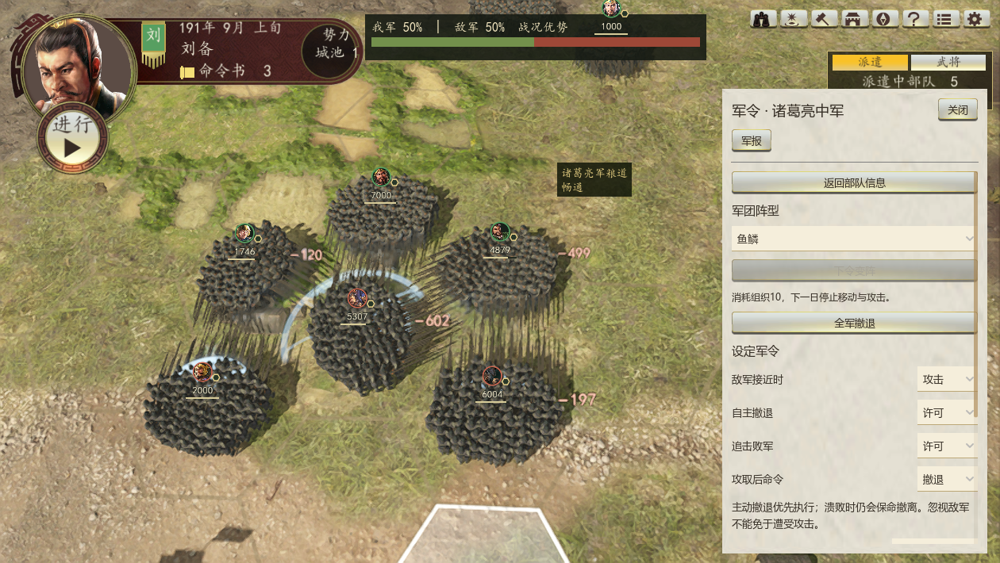
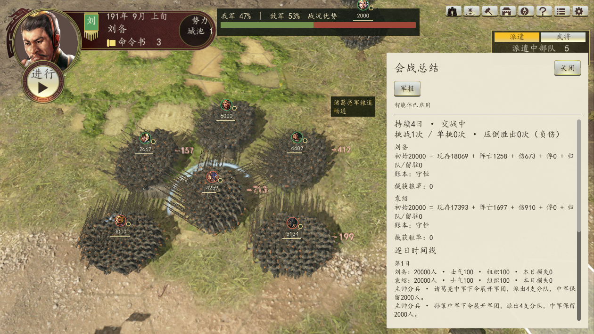

# 战斗系统扩展实现与验证

对应 [扩展设计](战斗系统扩展设计-2026-10-04.md)。地形、六种军团主阵、单挑、战况反馈均已接入现有规则结算、军团主帅决策、3D 地图与存档。数值均为可调原型参数。

开工保护点：`e10cf945cb3d37cd8c03b59967e5e755fce495ee`，Git 引用 `refs/codex/checkpoints/battle-extension-20261005`。保护点保存了当时已有改动，没有移动主分支或覆盖用户索引；本次实现尚未推送。

## 使用

1. 重启游戏，在主设置菜单点击“小沛中型对战 · 全武将出阵／重置”，进入军团测试，再点击“进行”执行十日。
2. 主帅部署时从六种主阵中选择。出阵界面当前只读介绍主阵，主帅负责首次选择与实际分兵。
3. 点击地图军队，在右侧查看主阵、熟练度、格子地形与将领伤势。选择阵型后点击“下令变阵”，全军下一个执行日整阵，停止移动与攻击。接敌时额外损失士气，三日内不能再次变阵。
4. 地图顶部显示战况优势，每日交战损失以飘字显示；军报页进入“会战总结”，查看挑战与实际单挑次数、阵亡/伤/俘/归队账本、截获粮草、城池攻防和逐日事件。

普通战役的敌军优势按侦察估计显示；未侦察的敌方真实士气与组织不用于优势条。小沛测试允许完整展示双方以便调试。模型只选择合法命令，伤亡、变阵成本、单挑和战局结果由规则引擎决定，不新增逐日模型等待。

## 地形

新增 [地形服务](../scripts/war/battle/battle_terrain.gd) 与 [实际码表](../data/war/terrain_table.json)。地表渲染、地图选格、战术寻路仍共用 `RTK14HexGrid.shared()`，没有创建第二套战斗网格。近战与远射使用目标格地形，战术攻城使用城池目标格；战略道路沿用区域地形。

全国审计覆盖 48,400 格、23 个码值。原设计候选的 8/9、15/16、13 含义有误，已依据原始 2D 标字地图改正：

| 原始码 | 原图标识 | 战斗类别 |
|---|---|---|
| 1、2、3 | 平、街、砂 | 平原 |
| 4、7 | 湿、毒 | 湿地，毒害机制不在本次范围 |
| 5、6 | 森、密 | 森林 |
| 8 | 低 | 丘陵 |
| 9、10、11 | 中、高、山 | 山地，10/11 仍不可通行 |
| 12 | 浅 | 浅滩/渡口 |
| 13、14 | 川、大 | 河川，不可通行 |
| 15～18 | 府、都、关、港 | 原型按平原结算 |
| 其余未归类码 | 未确认类别 | 回退平原，原有通行禁令仍独立保留 |

按用户确认，原 blocked 集新增 13，保留 12 可渡。浅滩进入当日不能攻击，山地进入当日攻击 ×0.85，下一日清除；长蛇免山地迟滞，不能绕过渡河禁攻。湿地额外增加每日疲劳。读取旧档时，若部队原先站在如今禁行的川格，则只对这些部队就近归岸，避免卡死；合法站位不移动。

证据： [全国统计与坐标](validation/terrain-code-audit.json)、[原图标字样例](validation/terrain-code-labels.jpg)、[七种类别实际 3D 样例](validation/terrain-3d-contact-sheet.jpg)。3D 核对覆盖码 1/4/5/8/9/12/13，其他已归类码依据 2D 标字图；没有声称重建原版全部地形材质或数值。

## 阵型、单挑与反馈

阵型服务在 [battle_formation.gd](../scripts/war/battle_formation.gd)。军团的 `formation` 与原有分队名册 `formations` 分开。鱼鳞、鹤翼、方圆、雁行、锋矢、长蛇按主帅有效布阵计算熟练度；分队继承主阵。侧击抗性、雁行远射、锋矢前两日冲击、方圆脱离准备与长蛇山林效果接入实际结算。变阵后，后台旧模型提案失效；主帅上下文含己方兵种、地形和敌兵种侦察估计，冷却期间不生成非法变阵候选。决策上下文不携带不断增长的会战日志。

单挑服务在 [duel_system.gd](../scripts/war/duel/duel_system.gd)。相邻主动近战可发起，远射、撤退、渡河禁攻或整阵不触发；每对将领每战一次，每将每战最多两次挑战，拒战同样占次数。道路同一交战线的增援与分队共用限额。统一战斗 RNG 完成三合判定，结果与 RNG 随存档保存。压倒胜出只使败将负伤、降低部队军心与组织，不减少兵力；带伤攻击 ×0.9，结束任务后休养十日，伤愈清除标记。与武圣首次威压同日互斥。现有交战扫击与火花增加单挑反馈，不是原版个人单挑动作复刻。

反馈服务在 [battle_feedback.gd](../scripts/war/battle/battle_feedback.gd)。优势条归一化，飘字每军每日一次、上限六条，暂停冻结；因子解释从实际乘区确定性选择一至两项，低军心与非平原地形优先显示。会战日志上限 240 条，记录侧击、单挑、破墙、溃败、援军阻断、断粮、占领与变阵，随存档保存。

总结的守恒等式针对出阵部队：初始 = 现存 + 阵亡 + 伤 + 俘 + 归队/留驻。城内守军伤亡通过城池攻防账本另列，避免把归队后加入城防的同一批士兵重复计算。未结束的普通战役隐藏敌方完整账本；主帅军令和实际战利粮草可查。旧存档缺少主阵时回退 `none`，缺少单挑和日志时补默认状态。

## 参数

统一修改 [campaign_rules.json](../data/war/campaign_rules.json) 的 `terrain`、`formations`、`duel`、`feedback` 四节。保留原战斗人物属性口径，`data/officers.json` 的“臂力”文本统一为“膂力”，人物数值没有重新叠加。

| 参数 | 默认 |
|---|---|
| 变阵组织成本 / 接敌额外士气成本 / 冷却 | 10 / 5 / 3 日 |
| 单挑发起 / 接受基础概率 | 0.12 / 0.55，随后应用性格与战况修正 |
| 每将每战挑战上限 / 负伤战后休养 | 2 次 / 10 日 |
| 带伤攻击倍率 | 0.9 |
| 每日飘字上限 / 日志上限 | 6 / 240 |

`allow_death=false` 为阵亡功能预留键，本次仍只实现负伤，不提供将领死亡玩法。移动力、火攻、个人兵器与护主机制不属于这份原型范围。

## 验证

四项独立验证：`terrain_battle_validation`、`formation_validation`、`duel_validation`、`battle_feedback_validation`。覆盖真实进入浅滩/山地、次日迟滞解除、旧档川格归岸、六阵倍率、玩家下一执行日变阵封锁、旧提案失效、固定种子性格抽样、每将两次限额、读档 RNG 复盘、负伤恢复、敌情权限、真实侧击/单挑/破墙回调和账本守恒。

合并回归通过 19/19，包括设计中的全部九项既有战斗回归，另加战略战争、军令、战斗平衡、特效、出阵和十日执行。完整输出见 [测试证据](validation/battle-extension-tests.json)。复跑：

```powershell
& 'C:\Python312\python.exe' -X utf8 tools/validate/validate_battle_extensions.py --godot 'C:\Godot_v4.7.2-stable_win64.exe\Godot_v4.7.2-stable_win64_console.exe'
```

实际 Vulkan 3D 验证：`battle_extension_ui_validation`，检查优势条、真实损失飘字与暂停、点击变阵、会战总结与七类地表样例。已检查实机渲染截图，非仅 headless 编译证明。







多种子验证 `battle_extension_campaign_validation`：每边 20,000 出阵兵，双方主帅决定分兵，最多 120 日；每个执行日检查占格与兵员守恒。对照在同一版本引擎关闭新增地形效果、阵型加成及单挑，并恢复川格旧通行，**不是旧提交二进制快照**。

| 种子 | 关闭新增效果：日数 / 结果 | 新效果：日数 / 结果 |
|---|---|---|
| 1910901 | 64 / 刘备 | 39 / 刘备 |
| 12345 | 91 / 平局 | 30 / 刘备 |
| 6482 | 91 / 平局 | 35 / 刘备 |
| 42 | 91 / 平局 | 25 / 刘备 |
| 98765 | 91 / 平局 | 91 / 平局 |

两组均正常结束且全程守恒，无占格冲突或禁行格穿越。平均结束日数 85.6 → 44.0，新效果四胜一平；五组样本说明当前默认小沛场景没有新增停滞，不代表全部阵型、模型策略或全国战役已达到最终平衡。逐日轨迹见 [种子对照 JSON](validation/battle-extension-campaign-seeds.json)。
