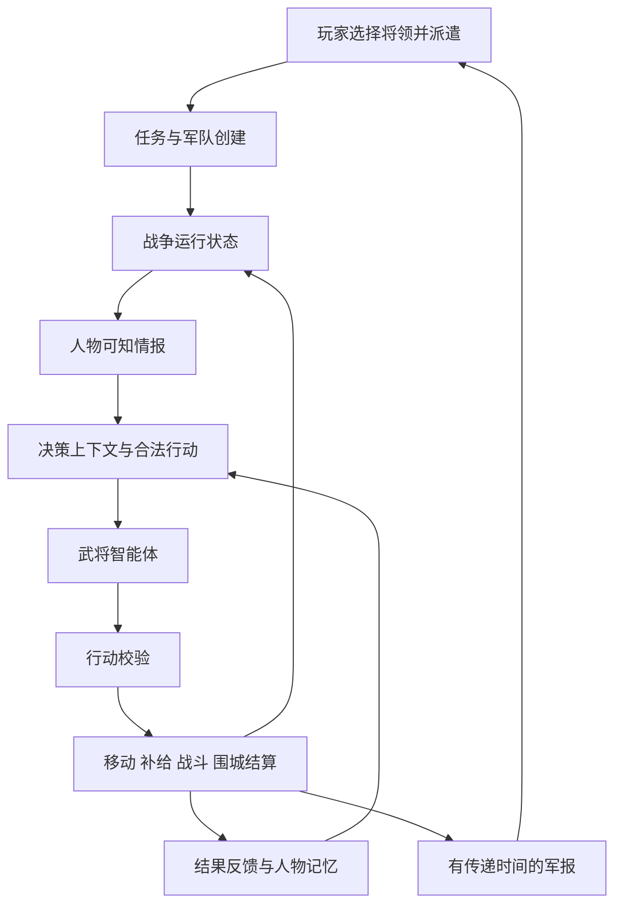

# 武将智能体自主战争方案

日期：2026-10-03。状态：建议方案，尚未实施。本文依据当前工作区代码与用户明确提出的“玩家只能派谁带兵出去，武将接入 AI 智能体自己决策”。参数、接口和文件名是拟定设计，不代表现有功能。

## 1. 游戏定位与玩家权限

玩家通过任命决定战争，把实际用兵交给人物。核心体验是：选择将领 → 观察其自主行动 → 从军报理解判断 → 承担结果 → 改善下一次任命与准备。

第一版推荐的出征界面只有三个必要信息：出发城、任务目标、主将。玩家点击目标城后选择主将并派遣；系统根据城池库存、留守要求和任务规模生成军队与携粮，显示资源消耗预览。兵种细节、路径、阵型、交战、计策、追击和撤退均由武将决定。

这里的目标是派遣任务的上下文。例如在敌城点“出征”，目标自然就是攻取该城；在己城点“增援”，目标自然就是守援该城。无需再增加任务参数面板。如果玩家确实只想选择人，任务可由势力当前目标自动带入，底层仍保存明确任务。

| 事项 | 第一版归属 |
|---|---|
| 任命谁出征 | 玩家 |
| 指定要解决的目标 | 地图派遣入口带入 |
| 配给多少兵、多少粮 | 动员规则自动生成，玩家看预览 |
| 选路、侦察、等待、交战、围城 | 主将智能体 |
| 追击、撤退、补给、求援 | 主将智能体 |
| 行动是否可执行、何时完成、损失多少 | 游戏引擎 |
| 接受求援、派遣另一位将领 | 玩家通过新的派遣决定 |

第一版出征后不开放直接控制军队和强制改写行动的按钮。时间暂停、速度调整与查看军报仍归玩家。后续若增加召回或改令，作为需要传递、可能延迟、由人物回应的军令，独立评估其对“只能派将”玩法的影响。

## 2. 当前项目能复用什么

本次直接核对：

- `project.godot` 的默认场景是 `scenes/map_slice.tscn`，并自动加载 `scripts/game_state.gd`。
- `data/world_map.json` 有 72 个据点和 107 条路线；路线已有稳定 ID、两端据点、成本和绘制路径。现有路线成本是演示权重，不能直接当作历史行军天数。
- `scripts/map_slice.gd` 已有路线查询、城池选择和归属显示，可提取为共享地图查询服务。
- `scripts/game_state.gd` 已有驻军、粮草、训练、军备、城防、城务命令和月结，存档版本是 1。
- `data/officers.json` 有 18 份人物档案，包含五维、25 项子属性与人物说明；部分人格、岗位和特性仍为文本。
- `scripts/rtk14_world_3d.gd` 提供三维地图表现，尚未看到完整战争运行状态和军队结算接入。
- `addons/godot_ai` 是编辑器与开发助手的连接插件，其存在不代表游戏内人物智能体已经实现。

现有缺口包括军队实体、派遣任务、人物运行状态、私有情报、战斗结算、决策协议和相关存档。本方案先在二维战略图运行；三维地图之后消费相同状态。

人物接入沿用已有设计中的 `DecisionContext` / `DecisionResult` 方向，参见本地《人物系统差距对照-2026-10-03》。本次没有重新核对该文档引用的外部 Notion 页面，也没有核对其他仓库的自主决策引擎；外部服务是否已有实现保持未知。

## 3. 总体架构



采用三个边界清楚的系统：

1. **战争模拟**：Godot 内的权威运行状态，推进日期、移动、资源、战斗和占领。
2. **人物决策**：独立接口，根据人物与可知局势选择下一步行为。
3. **表现与报告**：显示玩家目前收到的情报、军队状态、军报和人物资料。

智能体可以改变计划、选择打法、接受风险；它没有直接写入士兵数量、敌军位置、胜负、归属或新增物资的权限。决策后必须获得真实执行反馈，再决定下一步。

## 4. 每位武将如何成为智能体

每位出征主将拥有独立的任务、观测、计划、记忆和人格状态。可以共享同一个模型服务，无需每人启动一个模型进程。第一版每支军队一个主将智能体，敌我使用相同协议和可知范围。

### 4.1 接收什么信息

`DecisionContext` 仅包含：

- 当前身份、指挥权限、任务目标与任务阶段。
- 当前有效子属性、结构化人格、已实现的特性。
- 本军实际兵力、训练、装备、士气、组织度、疲劳与携粮。
- 本人知道的地图路线、地形、友军情况和敌军情报。
- 情报的来源、观测时间、收到时间、估计范围与可信度。
- 当前计划、已经投入的行程、最近的重要事件与少量相关记忆。
- 可执行行动、工具说明、估计代价与不确定性。

不输入未发现敌军、敌方真实库存、对手待执行计划或未来掷骰结果。路线预估与风险提示同样只能基于此人的观测，不能从真实全图状态泄漏信息。

### 4.2 能力与人格分别影响什么

| 属性或人格 | 建议影响 |
|---|---|
| 带兵、治军 | 指挥承载、行军秩序、组织恢复与溃散控制 |
| 布阵 | 接敌部署、阵地利用、指令执行效果 |
| 料敌 | 侦察判断的误差范围、情报复核效率 |
| 应变、沉着 | 新情况出现后的反应时间与临阵稳定性 |
| 奇袭 | 满足侦察、路线和隐蔽条件后的奇袭执行 |
| 水练 | 后续水战与渡河组织；第一版不制作完整水军 |
| 武艺、骑术等勇武子属性 | 主将亲临危险任务和亲卫的局部表现 |
| 威仪 | 士气稳定、动员与现场号召 |
| 风险承受、耐心、决断 | 选择行动的风险偏好、等待倾向和决策节奏 |
| 猜疑、自尊、忠义 | 情报采信、合作与服从任务的倾向 |

五维用于概览，具体任务优先读取子属性。沿用人物属性层次：当前基础 → 永久最终 → 场景有效 → 结果修正。现有导入已取部分箭头右侧最终值，不能把对应特性加成再加一次。

不能只在提示词里写“这个将领比较笨”。能力通过观测质量、反应延迟、执行效果产生实际差异；人格通过行动偏好产生差异。重要参数在规则中落地，模型负责对这些信息做取舍。

### 4.3 真实决策与基础行为的分工

大模型负责复杂任务下的计划选择：是否接敌、绕道、等待、围城、求援、追击或退却。规则与行为状态机负责执行既定计划：沿路线移动、按日耗粮、保持侦察、推进围城、计算战斗。

候选行动来自合法规则，但规则不会先选出唯一答案，再让模型写军报。对于同一局面，智能体应有多个真实选择；建议允许从有限工具生成由数个合法动作组成的计划，逐步执行并重新观测。

任务目标是人物选择的重要依据。第一版默认接受合法派遣，避免尚未实现的关系系统导致随机拒命。冒进、迟疑和谨慎先体现在执行方式。拒绝任命、违令、投敌等行为留到关系、价值观与身份职责数据完整之后。

## 5. 行动协议与执行约束

第一版使用明确枚举和有限参数，不接受任意代码或自然语言直接修改世界。

| 行动 | 用途与关键限制 |
|---|---|
| `march` | 沿已知连通路线行军，必须满足通行和移动条件 |
| `scout` | 侦察可到达区域，消耗时间并返回观测 |
| `hold` | 在当前位置等待或设防，仍消耗粮草 |
| `resupply` | 从可实际接收物资的友城补给，有库存和吞吐限制 |
| `engage` | 对已发现且能够接触的敌军采取进攻意图 |
| `besiege` | 包围或攻打敌城，校验守军、城防和现场条件 |
| `pursue` | 对可追上的溃败军队追击，继续承受疲劳与风险 |
| `withdraw` | 脱离交战或退往已知据点，可能受阻或被追击 |
| `request_support` | 通过军报请求增援，不凭空生成援兵 |

一轮决策最多提交一个主行动和一个报告类行动。`scout` 是游戏内真实行动，不能靠无限免费查询获取敌情。任务参数、可见目标、路线、资源和战斗状态均由引擎复核。

拟定输出示例，仅示意字段：

```json
{
  "request_id": "decision-00042",
  "army_id": "army-001",
  "observation_revision": 17,
  "intent": "保存兵力，转向有补给的友城",
  "action": {
    "type": "withdraw",
    "target_place_id": "luoyang"
  },
  "evidence_ids": ["intel-013", "supply-009"],
  "reason_summary": "发现敌方援军，本军余粮不足以持续围城。",
  "review_triggers": ["route_blocked", "enemy_contact", "supply_changed"]
}
```

理由是面向军报的简短摘要，不要求或存储模型内部思维过程。它只能引用上下文中存在的证据；数字、姓名、损失和归属由结构化事件核对与渲染。

引擎依次检查结构、身份权限、资源、动作前置条件和状态版本。观测版本校验只比较本人可知变化，不能因为秘密敌军发生变化而提示“计划过时”。世界真相导致行动受阻时，以真实遭遇产生的新观测反馈。

同一 `request_id` 只执行一次。迟到、重复或存档加载前的响应不能再次扣兵扣粮；已结束军队的请求直接失效。校验拒绝后最多修正一次，仍失败就启用基础策略，并在开发日志中标明。

## 6. 时间推进与决策调度

### 6.1 一个权威时间轴

战争以日为基础步长；战斗可在一天内执行固定次数的子结算，使损失和撤退有过程。所有军队共享相同日期，渲染帧率不决定模拟结果。

一个日结流程建议为：

1. 送达截至当日的军令与军报，更新各人物观测。
2. 从同一个日初快照为需要重判的军队组装决策请求。
3. 收集意图，校验并提交本日计划；模型响应顺序不产生先手优势。
4. 同步推进各军移动与物资，检测道路途中相遇和据点接触。
5. 在接触位置结算战斗、围城、撤退与追击。
6. 更新疲劳、组织、情报、任务状态和报告队列。
7. 到月末调用城务月结一次，保存状态。

同一条路上相向移动的敌军需要按路段进度检测相遇；不能让两支军队在据点之间交换位置后完全错过。相同时间发生的多支军队接触、增援和补给争用采用确定的规则处理，不依赖遍历顺序。

现有 `advance_month()` 需要拆出纯月结函数，由日期推进器调用。城内“进行”可以推进到下月，但遭遇重大军情或决策等待时停在对应日期。驻军目前按月消耗粮草；若改为统一日耗，必须移除同一部分月耗，避免重复扣粮。出征军队已从驻军扣除，也不能被城市再次计入消耗。

### 6.2 何时调用智能体

推荐事件触发：首次接令、发现敌军、敌情明显改变、通路受阻、补给中断、战况重大变化、围城出现突破机会、友军求援，以及任务完成或失去目标。

战斗内的紧急重判放在固定子步边界，统一生成观测并提交下一子步的意图。反应延迟由人物属性和规则决定，不能由网络延迟决定。

日常移动沿当前计划执行。添加最短计划保持期、风险变化阈值和事件合并，防止几条重复军报让主将在进攻与撤退之间反复摇摆。迫近的接触和真实资源耗尽可以打断保持期。

建议初始调用预算：常态每支军队每游戏日最多一次重要决策；一天内发生紧急情况可加一次。这个限制是可调的成本与节奏参数，预算耗尽后基础策略仍正常执行。

### 6.3 网络延迟与离线模式

所有需要决策的主将使用相同截止规则。第一版建议在重要决策批次等待时暂停战争日期，界面与镜头继续响应；到截止时间后，对尚未返回结果的军队使用基础策略。不能让一个模型响应慢的主将无故多挨数日攻击。

使用有上限的异步队列，合并过时事件，取消已完成任务的请求。断线时继续已有合法计划；计划失效时用人格与可知局势驱动的基础策略选择等待、补给或脱离危险。离线接管不能保证成功撤退，物理与战斗规则照常生效。

开发界面记录调用次数、输入输出量、等待时长、超时、重试和基础策略接管次数。模型供应商与规格通过适配器配置，先评测再选，不在方案里假定具体价格或服务能力。

## 7. 情报与军报

区分四种状态：真实世界、武将相信的情况、玩家已收到的军报、战后复盘中的真相。

情报记录至少保存 `source_id`、`observed_at`、`received_at`、位置/兵力估计、误差范围、可信度和过期条件。公开地理可以共享；敌军即时位置与兵力不能全局共享。友军协作也需要收到联络信息。

玩家通过军报看到将领上次报告的位置和状态，地图标记显示“消息截至第几日”。看到己军当前位置可以作为后续简化选项，但第一版推荐沿用军报时间，保持信息规则一致。调试观察模式可看全图真相，必须与正常玩法分开。

军报分三类：

- **行动报告**：正在侦察、改道、等待、围城等。
- **紧急军情**：遭遇强敌、粮道受阻、需要增援。
- **任务结果**：占领、失利、撤退归营及其资源后果。

自然语言只描述对应时点已经知道的情况。报告送达时可能已经过时，必须显示事件日与收到日。战后复盘展示当时情报、选择、实际经过和结果，让玩家判断是能力不足、误报、风险选择还是局势变化。

## 8. 军队、补给与战斗规则

以下是本项目的建议规则，不是 CK3 的原始公式。

### 8.1 军队与动员

第一版三类兵：步兵、弓兵、骑兵。每类记录当前参战人数、伤兵、溃散人员、训练与装备，军队层记录主将、任务、位置、士气、组织、疲劳和携粮。

现有城池只有驻军总数，需新增兵种库存。旧存档不能凭空补出稀有兵种；可先将历史驻军迁为基础步兵，弓骑由演示剧本明确设定，或后续征募获得。总兵数保持一致。

自动动员遵循：任务规模、城市兵种库存、留守下限、主将指挥承载和可供粮量。预览至少显示出征规模、留守兵力、预计携粮天数和准备是否不足。派遣确认时一次性扣除库存并创建军队，资源不足就不启动任务。

主将返回、战死、失踪或被俘都有明确占用状态。第一版没有副将接任时，主将失能后军队进入基础撤离流程；返回安全据点后解除占用。无人指挥不能变成免费永久驻外军队。

任务状态建议为准备、执行中、目标完成/任务失败、归营中、结束。攻取成功后仍要安排驻防与返程；撤退开始也不立即回收军队。目标消失、授权期限到达或军队完全失能时必须进入明确的终止流程，避免智能体无限等待。任务期限由任务规则产生并提前写入上下文，玩家无需额外设置。

### 8.2 补给

用统一的粮草单位和每日消耗系数，将库存换算为“可维持天数”，骑兵可增加马料消耗。系数先用于玩法标定，不声称现有“斛”的展示已经完成历史量纲校准。

第一版有携粮和友城补给：补给来源必须有库存，军队需要实际到达可接收物资的地点，粮草转移在双方账本同步发生。大军不能只因附近有友城就每天无限回满。

留存补给来源与通路字段，但完整运输队、物流吞吐网络和截粮作战放到后续。第一版通过切断到友城的可用通路限制再补给，不宣称已经实现运输队拦截。

缺粮先影响疲劳、组织恢复与士气，严重时才出现逃散和非战斗损失。是否冒险继续任务由主将判断，生理与资源后果由规则结算。

### 8.3 野战

沿用大地图接敌、持续消耗、地形与兵种影响的结构，并增加士气、组织和任务意图。

每个子步使用同一时点双方状态同时算出攻击效果，再一起扣除参战人员、更新士气和组织。部队参战比例由战场宽度、部署和兵种决定；大军有持续作战与轮换优势，狭窄地形限制同一时刻投入。

拟定计算链：

```text
有效参战人数 = 根据战场容量与部署分配的人数
攻击效果 = 有效参战人数 × 兵种基础输出
           × 训练装备修正 × 组织疲劳修正
           × 地形克制修正 × 有上限的指挥修正
人员损失 = 攻击效果对敌方兵种承受能力的结算
士气变化 = 战损冲击 + 侧击/包围冲击 + 补给压力 - 稳定作用
```

具体系数、叠加顺序和上限存入平衡配置，并用对照场景调节。用较温和且有上限的指挥修正，避免五维、子属性、特性、士气等各自再乘一遍，把名将放大成无敌单位。

勇武影响亲卫和危险行动的局部效果；个人不能直接替代整支军队的输出。出征初期主将决定作战意图，执行层实现推进、守势或脱离。计策要有真实准备和触发条件，不能仅凭一句模型叙述生效。

### 8.4 溃败、追击与围城

士气或组织越过溃败条件时，即使尚有大量兵员也可以败退。退却需要通路和时间；受阻可能被追击、包围或俘虏。主将决定是否追击，追击同时受到骑兵、疲劳、敌方掩护和补给限制。

人员账本区分阵亡、伤兵、俘虏、溃散和可重新归队人员。一次损失只记一次，追击继续处理剩余人员。返回城池时可归队兵力回到库存，伤兵进入恢复记录，俘虏与阵亡不会被补回。

围城独立于野战：守军、城防、存粮、包围程度和攻城准备共同决定进展。主将可选择继续围困、强攻、迎击援军或撤走；有兵在城外不自动等于占领。占领必须触发规则条件并更新驻军、库存、归属和任务记录。

## 9. 拟定数据与代码接入

| 对象 | 最小字段 |
|---|---|
| `OfficerState` | 人物 ID、势力 ID、当前岗位/位置、可用性、有效属性、疲劳、简要记忆 |
| `ArmyState` | 军队 ID、主将、任务、兵种/损失账本、士气、组织、疲劳、粮草、路段进度 |
| `Mission` | 来源城、目标、任务类型、资源授权、状态、成功/终止条件 |
| `Observation` | 来源、观测与送达时间、估计范围、可信度、过期条件 |
| `BattleState` | 接触位置、参战军队、地形、阶段、随机状态、损失与撤退进度 |
| `DecisionRecord` | 请求 ID、输入观测版本、模型与提示版本、结构化选择、校验和执行结果 |
| `Report` | 事件 ID、发出与送达时间、发送者/接收者、可展示的事实 |

人物当前 `faction` 为集团名称，城市用 `liu_bei` 等势力 ID。必须建立明确映射，并对当前剧本做身份安排，不能只凭名字相似自动归属。人物档案也不等于当前剧本年月的可出征状态；首个演示场景需显式选择可用人物与时期。

建议新增目录，而不是把所有逻辑继续塞入地图脚本：

```text
scripts/war/
  campaign_clock.gd          日期推进与月结入口
  campaign_state.gd          军队、任务、战斗和报告状态
  map_graph.gd               共享路线查询与通行规则
  mission_service.gd         派遣、动员、归营与任务状态
  movement_system.gd         路段移动与接触检测
  supply_system.gd           耗粮、补给和库存转移
  combat_system.gd           野战、追击与损失账本
  siege_system.gd            围城与占领
  observation_system.gd      私有观测与情报传递
scripts/agents/
  officer_context.gd         人物决策上下文
  decision_scheduler.gd      事件合并与调用队列
  decision_validator.gd      行动结构和前置条件校验
  baseline_policy.gd         常态行为与离线接管
  agent_adapter.gd           可替换的外部智能体接口
data/war/
  unit_rules.json            兵种与战斗配置
  campaign_rules.json        动员、补给、时间与预算配置
  demo_mission.json          首个演示战役
```

如果已有外部决策服务，只实现同一上下文/结果契约的适配器；不重复构建其内部框架。若尚无服务，先在独立决策层接模型 API，游戏运行状态仍留在 Godot。运行时模型凭据放在本地配置或服务环境，不写入剧本、存档或分发包。

存档升级到版本 2：保留原城务数据，增加日历、人物运行状态、军队、任务、战斗、报告队列与随机状态。迁移后默认没有在外军队，城池原有兵粮不变。对缺少字段做明确补齐，对不支持的未来版本给出可读错误。

保存已提交的动作及参数用于重放；精确重放读取这些动作与随机状态，不重新调用模型。同一输入重新问模型不保证得到相同决定。载入时取消旧网络请求，重新排队需要决策的任务，以防迟到结果跨存档生效。

## 10. 第一版界面

保持玩家侧简洁：

1. **出征预览**：目标、主将、自动配置的兵粮、留守情况，点击“派遣”。
2. **地图军队标记**：头像/旗帜、上次报告位置、当前已知任务状态；点击打开军报。
3. **军情列表**：按事件与送达时间呈现行动、求援和结果；紧急军情可暂停推进。
4. **战后复盘**：出发情况、重要决策、当时情报、战损与任务结果。

模型请求、成本、状态版本和调试真相只在开发面板展示。普通玩家看“等待军情”“侦察中”等游戏信息，不看原始 JSON。

## 11. 分阶段实现与验收

| 阶段 | 实现内容 | 完成判据 |
|---|---|---|
| A 人物与战役底座 | 标准属性/人格字段、势力映射、人物占用、任务/军队状态、共享地图图结构、版本 2 存档 | 同一武将不能重复出征；派遣、取消准备、存读档均不增减错兵粮 |
| B 自主出征流程 | 自动动员、日历、移动、侦察、基础策略、携粮、友城补给和军报 | 选将后无需操作，能出发、寻路、发现敌情、调整计划并归营；路上相遇不穿透 |
| C 战争结算 | 三兵种、野战、士气/组织、撤退、追击、围城和归属变化 | 能完成攻城或失利返回；兵员与粮草账本对得上，优势与劣势原因可解释 |
| D 接入真实智能体 | 私有上下文、行动协议、调用调度、校验、重试上限与离线接管 | 模型真实改变行动选择；未知敌情不进入上下文；超时与重复响应不影响合法性 |
| E 人物体验验证 | 人格行为对照、军报事实核对、战后复盘、成本测量与平衡 | 同一局面不同人物出现可解释差异，正常与断线流程都可完整结束 |

基础策略是用于验证规则和兜底的执行工具，不能把阶段 B/C 当作最终交付。首个可玩版本须完成阶段 D/E，验证真实智能体自主决策。

首个演示建议：一个出发城、一个敌城、一条短路与一条绕路、两支野战军、一处补给据点和一批延迟出现的援军。任务是攻取敌城。将领需要自行选择侦察、路径、是否接战、围城及是否撤退。支持替换不同主将重跑，比较行动与原因。

暂缓完整运输队、水军、军师/副将智能体、离间与投敌、长期关系网络、单挑、完整成长曲线及三维士兵阵列。后续扩展优先次序建议为：粮道运输 → 副将与军师协作 → 人物关系及违令 → 水战与复杂计策 → 成长与长期记忆。

## 12. 必须通过的检查

以下是实施时的验收要求，本次仅编写方案，未运行游戏测试。

- **资源守恒**：派遣、补给、战损、归营、占领与存读档都能追溯兵粮变化，没有负库存或重复结算。
- **战争时序**：相向行军、同日增援、多军接触和撤退受阻正确；同一日决策不因 API 返回顺序占便宜。
- **信息隔离**：对仅改变隐藏敌情、而人物观测不变的两份世界快照，生成的上下文和候选估计保持相同；秘密变化不会产生版本提示泄漏。
- **智能体可靠性**：未知动作、无权目标、伪造资源、畸形输出、超时、重复/迟到请求和存档切换均可控处理。
- **人格差异**：用多组同一任务、同一情报的场景统计侦察、进攻、等待、追击与撤退倾向；差异不能只存在于军报措辞。
- **能力边界**：强将有更好的观测、反应或执行效果，但在明显兵粮劣势下仍会失利；人格不保证胜率。
- **基础规则基准**：兵力、训练、装备、地形和补给单因素改变时，结果趋势符合设计；真实 AI 采用多次采样评估，不要求每次选择完全相同。
- **报告可信**：军报中的数字和事件有记录依据，区分发现时间与收到时间；正常界面不会暴露调试真相。
- **重放**：记录动作与随机状态后可恢复同一战役结果；记录规则、模型和提示版本以便定位变化。
- **调用预算**：实际测量不同军队规模下每游戏月的调用数、延迟与耗量，再据此选择模型和速度配置。

## 13. 参考与设计边界

本方案借鉴有工具、观测与环境反馈的智能体循环，以及从小而明确的行动接口开始并进行评测的工程原则。[Building Effective Agents](https://www.anthropic.com/engineering/building-effective-agents)、[Writing effective tools for AI agents](https://www.anthropic.com/engineering/writing-tools-for-agents)支持这些一般原则；文中的三国玩法、时间步、动作协议、预算与规则均为本项目建议，不来自这些文章，也不依赖文章中列举的特定框架。

项目依据：`project.godot`、`scripts/game_state.gd`、`scripts/map_slice.gd`、`scripts/rtk14_world_3d.gd`、`data/world_map.json`、`data/officers.json`、`docs/人物系统差距对照-2026-10-03.md`。本次仅新增此设计文档，未修改游戏源码与现有外部文档。
